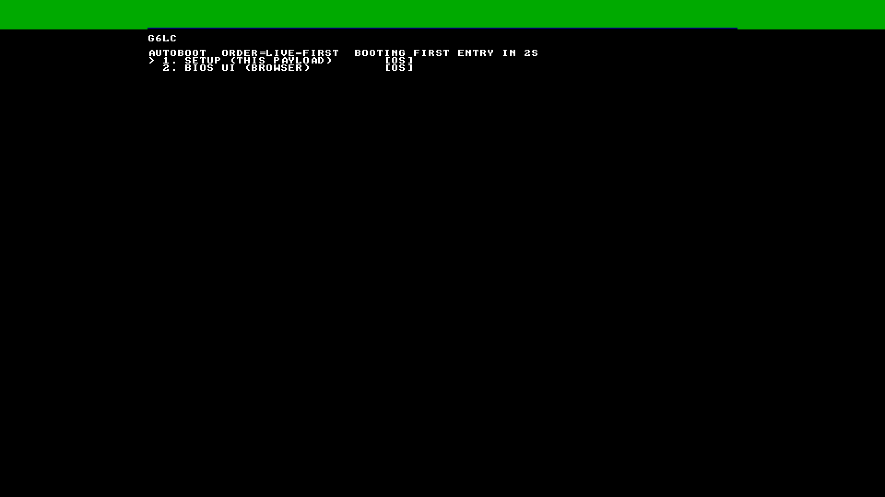
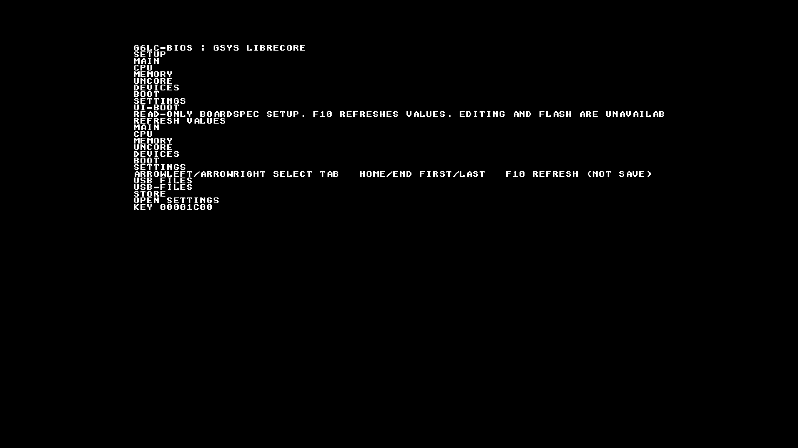
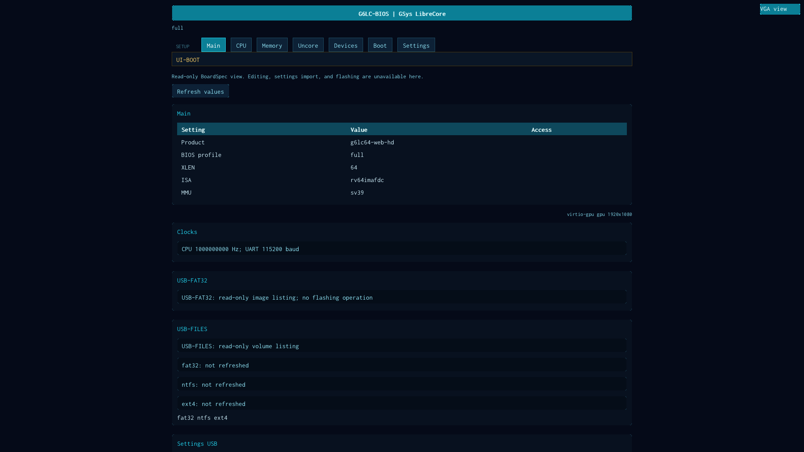
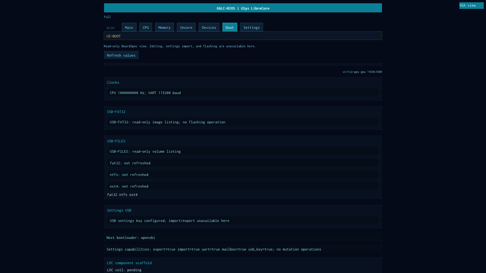
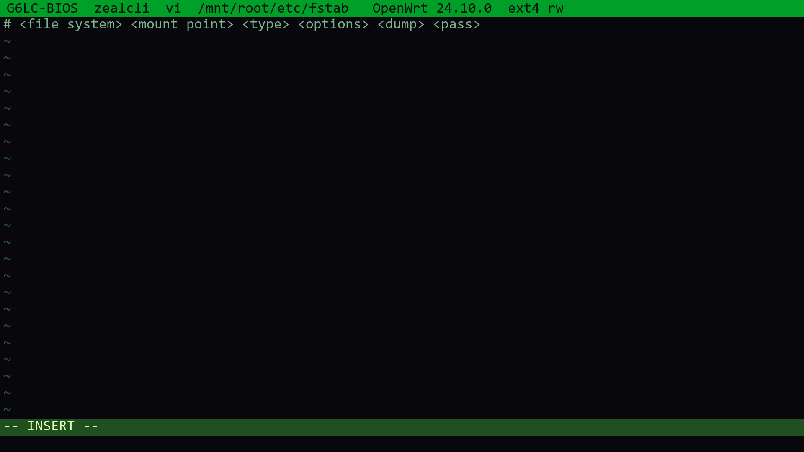

# g6lc_bios

Independent GSys LibreCore BIOS: a **rewrite** of TempleOS/ZealOS (those trees
are specs under `kernel-spec/`) as an S-mode setup kernel whose **display is
HTML+JS**, plus an SSH+HolyC KVM face, all from a BoardSpec. Inferences from
the spec forks must match LibreCore architecture (`architecture/PLAN.md`).

One BoardSpec drives two faces. The keyboard face is **zealcli**. The browser
face is `browser-ui/src/App.svelte` (`g6b-ui::setup_html`). They call the same
HolyC names and fail closed when a gate is off. Layout of the page:
[`architecture/SETUP.md`](architecture/SETUP.md). Kernel vs wasm/JS paint:
[`architecture/BROWSER-RUNTIME.md`](architecture/BROWSER-RUNTIME.md).

```
python tools/g6b.py check
python tools/g6b.py boot --spec fixtures/g6lc64-virt.json
python tools/g6b.py regress
```

QEMU (via the optional host; never Variane evidence):

```
g6q gen --emit bios-spec --target g6lc64_smt2 --machine g6lc-virt
g6q run --loader bios --dry-run --loader-image out/g6lc_bios.elf
# UART1 is the SSH-like HolyC port (default 2222); --holyc-port off disables it
```

The BIOS package does not depend on `g6lc_qemu`. See `AGENTS.md`.

---

## Three pictures

A screenshot of one is not a proof of another. Captures below are 1920×1080.

| Picture | What runs | What the shot shows |
|---|---|---|
| Host CSS | `BrowserSession` + `g6b-css` (`g6b display-proxy-32`) | Styled setup page |
| Guest glyph | First-party `bios-ui.wasm` → `__ui_dom` → `DomPaint32` | Flat rows on virtio-gpu |
| zealcli | `g6b zealcli` / guest CLI | 80×25 keyboard container (VGA plane) |

`fixtures/g6lc64-web-hd.json` sets `kernel.wasm.jit` and leaves `guest_jit`
false, so a QEMU screendump of that ELF is the glyph face, not CSS.

### Autoboot CLI picker (QEMU virtio-gpu)

`kernel.cli.boot=auto`. Two entries: this payload, then BIOS UI. Serial:
`AUTOBOOT-READY`, `AUTOBOOT-PICK bios-ui`, `AUTOBOOT-UI`. The 4bpp CLI plane
is expanded onto 1920×1080 while the container owns the screen.



```
bash tools/qemu_web_autoboot.sh out/g6lc_bios-web-hd.elf OUT_DIR up
```

### Guest BIOS UI (glyph rows)

After the picker takes BIOS UI. Flat `__ui_dom` text, not goosie CSS.



### Browser UI, host CSS, 1920×1080

`g6b display-proxy-32 --spec fixtures/g6lc64-web-hd.json`. Main tab and Boot
tab. Header **G6LC-BIOS | GSys LibreCore**, seven setup tabs, `virtio-gpu gpu
1920x1080`.





```
g6b display-proxy-32 --spec fixtures/g6lc64-web-hd.json --out out/browser-ui-hd.ppm
python tools/ppm2png.py out/browser-ui-hd.ppm out/browser-ui-hd.png
# Boot tab: G6B_SETUP_MENU=boot
```

---

## zealcli on an OpenWrt drive

The S-mode payload still has no virtio-blk reader (`AUTOBOOT-HANDOFF no block
reader in this payload yet (B98)`). The same zealcli session on the host
opens a real image with `--disk` (`g6b-vfs` GPT/ext4). Official OpenWrt
24.10.0 sifiveu Unleashed ext4 sdcard (~141 MiB GPT):

```
ow       OpenWrt-sdcard                 141M gpt
  ow:1  loader1      unknown   1M   no driver
  ow:2  loader2      unknown   4M   no driver
  ow:3  no-name      fat16    32M   no driver   (ESP; BIOS FAT32 only)
  ow:4  rootfs       ext4    104M   mountable
```

```
g6b zealcli --spec fixtures/g6lc64-zealcli.json \
  --disk ow=openwrt-sifive-unleashed-ext4-sdcard.img:OpenWrt-sdcard \
  --script - --then-keys 23 <<'EOF'
mount -w ow:4 as root
cd root:/
vi etc/fstab
EOF
```

`mount -w ow:4 as root` reports `installed: OpenWrt 24.10.0`. `vi etc/fstab`
then Linux `KEY_I` (23) is insert. Stock OpenWrt fstab is the comment header.



`g6b vfs scan|ls|cat|os --disk IMAGE [--part 4]` is the same driver without
the shell. Packed `--volume` on `g6b elf` is what the guest autoboot picker
lists (for example `OpenWrt 24.10.0-sifiveu-generic [firmware]`).

More: [`architecture/g6b-zealcli.md`](architecture/g6b-zealcli.md),
[`architecture/DISPLAY.md`](architecture/DISPLAY.md),
[`architecture/g6b-vfs.md`](architecture/g6b-vfs.md).
