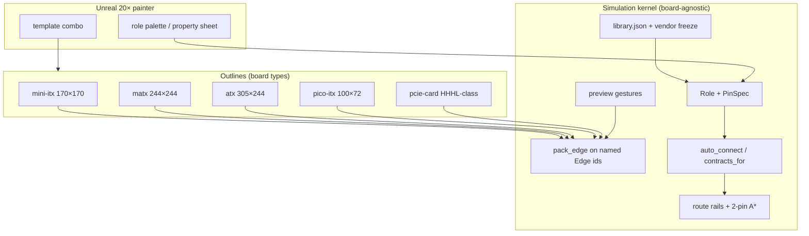

# Board outlines vs simulation kernel

| Field | Value |
|---|---|
| **Title** | Board form-factors independent of pin, path, and library simulation |
| **Author** | mbgen architecture |
| **Date** | 2026-10-09 |
| **Status** | v1 complete, on `E:\cva6` master (`df9aff1`) |
| **Parent** | `architecture/pin-circuits.md` |

---

## Split

mbgen has two layers that share integer micrometres and **do not share control flow**.

| Layer | Owns | Live type | Does not own |
|---|---|---|---|
| **Outline** | Board size, I/O window, slot pitch and count, named edges, sit datums, 1.6 mm PCB thickness | `Template` in `mbcore/src/template.rs` | Pin kinds, nets, pathfinder, vendor freeze, palette, combo boxes |
| **Simulation kernel** | Roles, `PinSpec`, nets, anchors, `auto_connect`, `route`, gestures, `library.json` | `Role` / `LibraryRow` / `Pin` / `Net` / `Path` / `Gesture` | Which millimetre outline is selected |

A `Design` is `template_id` + ports + placements + `settings.package_id`. Changing Mini-ITX to ATX or to a PCIe card swaps the outline. The same `Place`, `Delete`, `SetProperty`, `AutoConnect`, and `route` functions run.

## Live outlines

`template_by_id` today (`mbcore/src/template.rs`):

| id | Size (µm) | Slot count | Notes |
|---|---|---|---|
| `mini-itx` | 170000 × 170000 | 1 | Default `builder.json` `"template"` |
| `matx` | 244000 × 244000 | 4 | `pc_outline` |
| `atx` | 305000 × 244000 | 7 | `pc_outline` |
| `pico-itx` | 100000 × 72000 | 0 | No I/O window, no slot edge span |
| `pcie-card` | 167650 × 68900 | 0 | HHHL-class card; edges `cem` / `bracket` / `island` / `power` |

The four motherboard outlines share the **same edge names**: `rear_io`, `drive`, `front`, `cpu`, `memory`, `slot`, `phy`, `power`. `pcie-card` uses `cem` / `bracket` / `island` / `power`. `pack_edge` keys on those strings. A role’s `Role.edge` is a **default home** on that name, not a Mini-ITX constant.

`virt-ai-pcie` under `corev-mb/architecture/virt-ai-pcie/` is a **hostless** virtual card (no PCB, SKiDL omitted). It is not an mbgen `Template`. The mbgen PCIe **card outline** is `pcie-card` (HHHL-class 167650 × 68900 µm, edges `cem` / `bracket` / `island` / `power`, role `pcie_cem` with empty names until a card-edge freeze).

## Independence rules (tests)

These functions take a `Design` or a `role` string. They **must not** match on `template.id`:

- `pin_spec(role)` / `pins_for(role)`
- `contracts_for(role, names)`
- `library_for(role, ai)`
- `auto_connect(design, pin_spec)`
- `route(design, pin_spec)` occupancy and A*
- `Gesture::Place` / `Delete` / `SetProperty` / `AutoConnect` after pack
- `library.json` export

A unit test builds the same `pcie_slot` + `sata` port list on `mini-itx` and on `atx` and asserts equal `pins_for` and equal `contracts_for`. Occupancy AABBs differ because `scene()` poses differ; pin membership does not.

`pose()` may read `Template` fields (`board_w_um`, edge spans, sit datums). Circuit membership never calls `mini_itx()` by name.

## Role.edge vs outline edges

`role("pcie_slot").edge == "slot"`. ATX’s `slot` edge is `s_max = 7 * 20320`; Mini-ITX’s is `20320`. Same role, longer datum. A `Design` placement may set `Placement.edge` to any edge id the template defines. Missing edge → `PackError`, previous design kept.

Sit special-cases in `scene.rs` `pose()` (NVMe left rail, PCIe in front of CPU, DIMM at `board_d/2`) are **outline sit-rules** on `Template.sit` (`cpu_y_frac`, `nvme_rail_x_um`, `slot_y_um`, plus power/phy/drive insets). Mini-ITX / mATX / ATX share `motherboard_sit()` (cpu Y scales with board depth). Pico-ITX uses `pico_sit()`. `pcie-card` uses `card_sit()`. `pose()` reads those fields and never matches `template.id`.

## PCIe card outline

Live `Template` id `pcie-card` (HHHL-class public CEM outline, 167650 × 68900 µm). Edges:

| Edge | Datum | Default roles |
|---|---|---|
| `cem` | Gold-finger length along the card | `pcie_cem` (new role, NamesOnly empty until a **card-edge** MPN is frozen) |
| `bracket` | I/O bracket | rear-facing gaps (USB-C Gap, etc.) |
| `island` | AI / uncore courtyard | `ai_island` when `PackageCard.ai` |
| `power` | Card power nodes | VTT/decap as on motherboards |

The motherboard **slot** (`pcie_slot`, freeze of slot LCSC C426228 when present) and the card **gold finger** (`pcie_cem`) share the **CEM contract family** (`P12V` / `P3V3` / `P3V3_AUX` / `GND`) via `contracts_for`, keyed by role. They do **not** share the slot MPN. Card-edge freeze is a separate file; until it exists, `pcie_cem` is `NamesOnly { pins: [] }` or `Gap`. No BAR MMIO in mbgen. Firmware `base` stays `""`.

The card uses the same simulation kernel: typed pins when declared, from-to nets, silent `NetError` badges, combo-box `SetProperty`, palette add, XY `Place` on the card PCB top, Del to delete, `compile()` → `nets.json` / `paths.json`. A missing socket badge is skipped on `pcie-card` (`has_cpu` is false).

## Unreal UI

Two pickers:

1. **Board** combo: `template.id` (`mini-itx` / `matx` / `atx` / `pico-itx` / `pcie-card`). Issues `Gesture` that swaps `Design`’s template and re-packs. Palette contents stay the role library.
2. **Parts** palette (L): roles from `library.json`, search by role / MPN / LCSC, letter/hatch thumbs. Click `Add`. Drag a row onto the PCB top to `Add` then `Place`. Independent of which outline is loaded.

`LiveRouting` (default false) loads `mbcore_c` for dirty `mb_route` after a legal gesture. The kernel is the same on every outline. USB Type-A and the unnamed socket stay pinless on Mini-ITX.

Property sheet is per **part**, not per board type. A `pcie_slot` on ATX and a `pcie_cem` on a card both show Support (read-only) and the same CEM contract names when freeze exists.

## Compile and ingest

`compile(&design)` already takes whatever `template_id` is on the design. `builder.json` `"template"` selects the outline at project generate. `mb ingest` still keys on `platform.json` / `core.config`, not on Unreal meshes. A PCIe-card compile is a different `platform.json` board id; unknown cores still refused.

## Non-goals

- Folding `virt-ai-pcie` (hostless TCP card) into mbgen `Template`.
- Inventing a PCIe card-edge pinout or BAR map.
- Per-board copies of `route.rs` or `auto_connect`.
- Unreal branching mesh code on `mini-itx` vs `atx` for nets.

## PR

See `pin-circuits.md`. Outline vs kernel split landed as **PR 1b**; `pcie-card` is live. Live routing / cdylib is **PR 8–9**. Docs **PR 10**.
