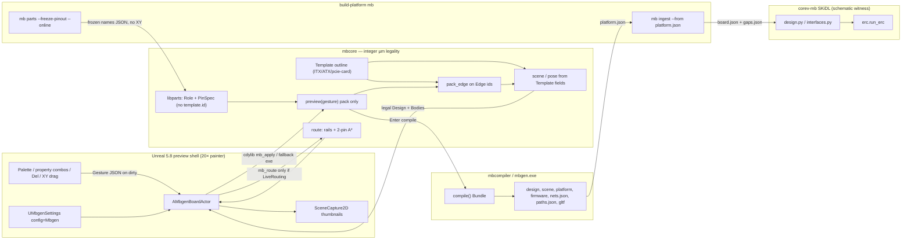
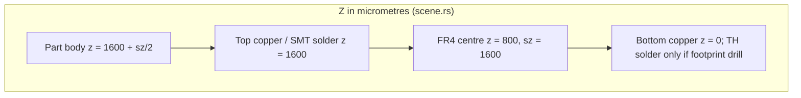

# mbgen Pin Circuits, Pathfinding, and Live Preview

| Field | Value |
|---|---|
| **Title** | Pin-specific circuits, under-board solders, and a catalog-backed live sim for mbgen |
| **Author** | mbgen architecture |
| **Date** | 2026-10-09 |
| **Status** | v1 complete (uncommitted, rev 6) |
| **Scope** | Architectural update to the existing independent builder at `E:\cva6\mbgen` and its ingest into `corev-mb`. Not a greenfield CAD product. Board outlines (ITX/ATX/PCIe card) are a separate layer from pin/path/library simulation (`architecture/board-types.md`). |

---

## Overview

mbgen already places Mini-ITX parts in integer micrometres, packs them along named edges, and lets Unreal 5.8 paint a 20× preview. Gestures (`Add`, `Nudge`, `Drag`, `Copy`) either produce a new legal `Design` or return the previous one unchanged. Compile emits `scene.json`, `platform.json`, `firmware.json`, `nets.json`, `paths.json`, `errors.json`, a GND-only stub `board.net`, and a SKiDL sketch. That is enough to orbit a board. It is not enough to treat every **declared** pin as a typed circuit, to auto-resolve legal connections from a property sheet, or to drag a part in **XY on the board plane** while legal traces (when pad geometry exists) follow.

This update keeps the split that already exists: **mbcore owns legality and arithmetic**, **Unreal paints**, **SKiDL remains the schematic witness**, **pcbparts.dev remains the pollable vendor library**, **BIOS/firmware remains a witness**. **Board outlines** (`Template`: Mini-ITX, mATX, ATX, Pico-ITX, PCIe card) are independent of the **simulation kernel** (roles, pin types, from-to nets, pathfinder, anchors, vendor freeze, palette, combo boxes). A PCIe card board uses the same kernel; its CEM gold-finger role carries pin types and contracts when freeze exists. See `architecture/board-types.md`. The new work adds a pin/net/path/anchor model in mbcore, a compact integer pathfinder (top and bottom copper; solder hits only when a frozen footprint documents a drill), a compiler-facing common library of *roles* (not invented SKUs), dirty-driven live routing behind a default-off flag, and Unreal UI that feels like a game: sidebar parts with thumbnails, search by role/MPN/LCSC, combo-box properties, XY snap to anchors, Del to delete. Auto-connect is silent (no modals) and **domain-safe only**. USB-C and Wi-Fi stay `Support::Gap` until a catalog MPN/pinout exists. A Bluetooth **label** on `wifi_m2` is UI-only (no extra pins or body). The unnamed CPU socket land grid stays unnamed. USB Type-A stays a hatched D-gap with a tongue and **no pins**. HDMI/LAN mouth meshes stay decorative until a cached pinout **and** pad geometry exist.

---

## Background & Motivation

### What is live today

The independent builder is a two-crate workspace plus a generated Unreal project:

| Piece | Path | Job |
|---|---|---|
| Shared arithmetic | `E:\cva6\mbgen\mbcore\src\` | Integer µm packing, scene poses, gestures, compile bundle |
| CLI | `E:\cva6\mbgen\mbcompiler\src\main.rs` | `preview`, `compile`, `scene`, `anchors`, `library`, `textures`, `package`, `build`, `open`, `mini-itx` |
| Unreal 5.8 shell | `E:\cva6\mbgen\mbsim\MbgenSim\` | 20× procedural mesh, orbit/pan/zoom; `mb_apply` on `mbcore_c`, `mbgen.exe preview` fallback |
| Board ingest | `build-platform/src/cli/commands/mb.ts` `cmdIngest` | Copies `platform.json` into `corev-mb/boards/<id>/`, refuses unknown cores |
| Schematic | `corev-mb/lib/{interfaces,soc,erc,pcbparts_mcp}.py` | SKiDL ERC + pcbparts cache-first catalog |

mbcore's contract is already the north star of any live sim (`mbcore/src/lib.rs`):

> A gesture either returns a new legal design or the previous design unchanged, with a reason. Unreal paints the result and does not keep a pose this library rejected.

Lengths are integer micrometres (`DEFAULT_GAP_UM = 1_500`). Authored placement is `edge + s_um + stack + pinned` (`template.rs` `Placement`). World XYZ is **computed** in `scene.rs` `pose()`, not stored. Unreal converts µm to centimetres (`ToCm = 0.0001f`) and scales the actor 20× so a 1 mm pitch is 2 cm (`MbgenBoardActor.cpp`). Part X/Y in Properties are absolute from the board 0,0 corner in the Settings unit (µm/mm/cm/m/mil/inch); Enter applies `Place`. Top-right Settings/Props/Undo/Redo/Save/Open/Copy/Paste write `Saved/mbgen.sqlite`. **Place** uses actor-local centimetres on the live PCB top from `scene()` AABB (see Screen → µm) and stores both board-plane axes (`Placement.x_um` / `y_um`); Z stays sit-on-PCB. `Turn` is a quarter-turn around that normal. Right-drag orbits around the pick; the wheel zooms toward the cursor. `world_um = world_cm * 500` is only a debug assert after dividing out the 20× scale. The actor does **not** tick (`PrimaryActorTick.bCanEverTick = false`). Gestures go through `mb_apply` on `mbcore_c` when the DLL loads, with `mbgen.exe preview` as fallback. Unreal rebuilds from the returned `design` only when `applied` is true. Solder-mask silk and courtyards are generated from `Template` size and `scene()` AABBs (`textures.rs`); they do not hard-code Mini-ITX millimetres. `SetOutline` runs `mbgen textures --design … --out Content/Textures` and reimports `T_Solder*`. Compile does not rewrite silk (editor startup already imports the PNGs). Socket land dots in the map are 1 mm in board millimetres, not pixel modulo. Non-square outlines write a matching-aspect solder map (ATX 512×410) so UV 0–1 on the PCB does not stretch millimetres.

`catalog.rs` is **not** a chip SKU catalog. It is:

- `PackageCard` — LibreCore config packages (`cv64a6_imafdc_sv39`, `g6lc64_ooo_int`, …) offered by the processor window.
- `LibraryRow` / `Support` — `Board | Integrated | Listed | Gap` plus an optional **vendor controller id** (`verilog-ethernet`, `litedram`, `verilog-pcie`, …), not a distributor MPN.

USB is a recorded gap:

```text
"usb_stack" | "esd" => Support::Gap, "USB host controller is not in the vendor catalog"
```

The Unreal mesh matches that: USB Type-A D-shaped bezel, plastic tongue, **no USB pins**. HDMI/LAN still get mouth pin **meshes**. Those meshes are not circuits. The CPU socket is a 1 mm `PlacePads` land grid with **no named pinout** (`architecture/mini-itx/README.md`). `compile()`'s netlist ties every part to a single `GND` net and the generated SKiDL does `part['GND'] += gnd`. That is a compile witness, not a pin-accurate circuit.

corev-mb already has the beginnings of pin **names**, and only there:

- `interfaces.py` `_KIND_DISTRIBUTOR` records JLCPCB MPNs **and** LCSC ids for `sata`, `dimm`, `nvme_m2`, `front_panel`, `pcie_slot`. Pin lists come from `jlc_get_pinout` (cache-first) as `{number, name}` **only** — no pad XY. Those five kinds are recorded **because** `cse_get_kicad` has no footprint; `attach_catalog_footprints` leaves the footprint empty.
- PCIe CEM rails `P12V` / `P3V3` / `P3V3_AUX` / `GND` are tied by **name** (`_tie_pcie_slot_power`) only after `_distributor_pins` returns a real pinout. SATA grounds 1/4/7 are tied the same way. Otherwise SKiDL uses a generic stub and `_leave_open_pins`.
- `attach_catalog_footprints` never invents a KiCad name. USB, HDMI, PHY, SPI flash, ESD, crystal, VTT have `_KIND_QUERIES` candidates; a miss is unresolved, not fabricated. `W25Q128JVPIQ` is a search candidate, not a shipped pin table.

Firmware (`export.rs` `firmware` JSON, consumed by g6lc BIOS `BoardSpec`) lists peripherals with `"base": ""`. BIOS may infer uncore flags from class names (`infer_uncore` in g6b-spec). It must not invent MMIO.

Live Mini-ITX body count: `Design::mini_itx` has 12 ports; `expand_hidden` adds PHY+crystal per magjack, ESD per USB, VTT, and `clamp((core_ua+99999)/100000, 2, 8)` decaps → 20 placed parts + pcb + shield ≈ 22 bodies. Named **circuit** pins today are **zero**. Mesh contacts (PCIe 17+17 springs, DIMM `Floor(sy*0.78/0.1)` per lip, socket ≈ 26×26 unnamed pads, USB none) are decorative.

### Pain points

1. **Preview pins are mesh, not circuits.** `PlacePins` / `PlacePads` in `MbgenBoardActor.cpp` (`mbcompiler` `include_str`s that file) draw 1 mm pitch contacts. They have no `Pin.id`, no domain, no net, no from-to. They must not become A* starts. Pico-ITX and `pcie-card` have `window_h_um = 0`; a degenerate shield mesh is destroyed, `MakeWell` skips size under 0.02 cm, and product captures skip bodies under 1 mm.
2. **Gestures are 1-D.** Landed: Place on the PCB top (both board-plane axes), Del, Copy, `mb_anchors` snap ticks, property sheet, `Turn` `yaw_q`, arrow keys Place 1 mm / Shift 0.1 mm on X/Y.
3. **Compile connectivity is a stub.** One `GND` net. No named CEM rails, no rebuildable path records. That stub must not be upgraded by inventing a WSON-8 or RGMII map.
4. **Unreal talks to mbcore by spawning an exe.** Landed: Play/editor gestures apply via `mb_apply` on `mbcore_c` when the DLL loads; `mbgen.exe preview` is fallback. The actor does not tick. A second physics/spline solver would break the rejected-pose contract.
5. **The chip palette does not exist.** Landed: `UMbgenLibraryWidget` with first-open thumbs, role/contract search, USB-C and `wifi_m2` Gap rows. `UMbgenPackageWidget` remains the processor-card list.
6. **Vendor polling is already solved** in build-platform (`pcbparts.ts`, `--online` / `PCBPARTS_ALLOW_NETWORK=1`) and mirrored in `pcbparts_mcp.py`. Unreal must not grow a third client.
7. **`[/Script/MbgenSim.MbgenSettings]` was generated but unused.** Landed: `UMbgenSettings` (`config=Mbgen`) reads Design/Scene/`LiveRouting`/`LiveRouteHz`/`DllPath` from `Config/Mbgen.ini`.

---

## Goals & Non-Goals

### Goals

- Every **declared** pin has a type, a voltage domain, a board side, and — **only when a real footprint supplies pad geometry** — a micrometre offset from its part origin. Names-only pins (frozen `jlc_get_pinout`) participate in auto-connect, not in A*.
- Auto-find connections, or resolve them from a property combo, **only** when pin kinds, domains, and a **named contract already tied in `interfaces.py`** match, and only when the frozen distributor list actually contains those names.
- Game-like sim: add from a searchable sidebar of roles (3D thumbnail cache), move in **XY on the board plane** along anchors, delete with Del, quiet badges instead of modal error dialogs.
- Domain-safe auto-connect (GND–GND, named CEM/SATA power) that **silently** ties legal nets and **visibly** leaves gaps for the rest.
- Under-board solder hits only when a frozen footprint documents a pad drill (`PinSide::Through`). v1 instantiates `PinSide::Top`. Socket remains `UnnamedGrid` with **no** solder hits.
- Exportable pathfinding: compact integer records; traces rebuilt by the same mbcore arithmetics. Power/GND are rails, not 2-point A*.
- Compile still produces a complete board bundle; ingest still refuses unknown cores.
- BIOS/processor property sheet infers as specifically as the `PackageCard` and catalog pinouts allow, pin-per-pin only from allowed sources.
- Board form-factor selection (`Template`) is independent of pin/net/path/library/gesture algorithms. The same kernel runs on Mini-ITX, ATX, and a PCIe card outline.

### Non-goals

- A second placement implementation in Unreal, Niagara, or splines.
- A full KiCad/FreeRouting in-process autorouter.
- Inventing a USB PHY, USB pinout, stacked USB, USB MMIO, or USB host controller.
- Inventing a CPU socket pinout, KiCad footprint, PHY identity, distributor part, WSON-8 map, RGMII map, or HDMI pinout.
- Dual-writing SKiDL from Unreal on any paint.
- Merging mbgen into `corev-mb` or running SKiDL inside `mbcore`.
- Network from Unreal (no HTTP in `MbgenSim`).
- Promoting USB-C / Wi-Fi / Bluetooth from `Gap` without a catalog MPN/pinout.
- Firmware inventing RTL, CSRs, or MMIO bases.
- Changing Mini-ITX overlap rules or the 1.6 mm PCB sit (`z_um = 1600 + sz/2`).
- A* from Unreal `PlacePins` / `PlacePads` pitch.
- Occupancy inflated by `DEFAULT_GAP_UM` (that constant stays the **pack** courtyard).
- `Placement.xy_um` / off-edge free plane in v1.
- Unreal async route tasks in v1.
- Per-board copies of `route.rs` / `auto_connect` / `pin_spec`.
- Matching on `template.id` inside the simulation kernel.
- Folding hostless `virt-ai-pcie` into an mbgen `Template`.

---

## Key Decisions

### A. Dirty-driven mbcore routing vs Unreal-owned cables

**Decision:** Unreal requests a gesture on dirty (selection change, drag end, combo change, Del, palette drop). Optionally, while dragging with live routing on, it may request at most 10 Hz from the **input preprocessor**, never from `AMbgenBoardActor::Tick` (that stays `bCanEverTick = false`; Play orbit tick stays on the controller). mbcore packs in integer µm and returns a `PreviewResult`. Unreal draws that design and **must not keep a pose mbcore rejected** — including unpinned neighbours `pack_edge` reflowed. Unreal **may not lerp or locally transform** a part that `preview()` has not accepted. Snap is a proposed `(x_um, y_um)` **inside the gesture**, computed from the PCB-top hit; the actor does not move first. Incremental paint updates **every body whose `scene()` pose or extents changed**, plus dirty path strips. "Dirty-driven" / "10 Hz gated requests" are the terms; "frame" is reserved for paint. This is **not** a 60 Hz physics cable solver and not a second occupancy grid in C++.

**Rationale:** `lib.rs` already forbids Unreal from keeping an illegal pose. `AMbgenBoardActor` already implements that for nudges. Spawning `mbgen.exe` per paint cannot hit a 100 ms period. A C ABI of mbcore keeps the same JSON gesture contract in-process. Unreal continues to convert µm → cm × 20 and tessellate; it does not route.

### B. Silent auto-connect vs not inventing nets

**Decision:** Auto-connect only when **all** of these match: pin `kind`, voltage `domain`, and a **named interface contract already tied in live `interfaces.py`**, **and** the frozen distributor pin list actually contains those names. Today that is **only** PCIe CEM rails `P12V` / `P3V3` / `P3V3_AUX` / `GND` (`_tie_pcie_slot_power`) and SATA grounds `1` / `4` / `7`. `contracts_for` is empty for `dimm`, `nvme_m2`, and `front_panel` even if freeze names include `GND`/`VDD`/`VTT` — those stay names-only `Pin`s and `_leave_open_pins`, matching SKiDL. Mismatches stay `NetError` and paint as gap badges (`GAP` on Support::Gap bodies, `SOCKET GAP` when the socket port is gone, `OPEN`/`UNROUTABLE`/`DOMAIN` from `mb_route` errors). "Silent" means **no modal dialogs**. It does **not** mean hiding illegal nets, inventing a PHY, inventing MMIO, filling USB/socket holes, or shipping a hand-written WSON-8 / crystal / RGMII / HDMI table. SPI, crystal, PHY, decap, VTT, HDMI, magjack magnetics stay `Gap` or `Catalog { mpn }` with **empty pins on miss**.

**Rationale:** Today's SKiDL scaffold ties power by name only after a real pinout, then `_leave_open_pins`. mbgen must not become more inventive than the schematic witness (`AGENTS-mb-skidl.md` §0: never invent an MPN, a pinout, or a footprint).

### C. USB-C / Wi-Fi / Bluetooth in the library

**Decision:** New **roles**, not fake pinouts. `wifi_m2` already exists (`template.rs` role, `Support::Gap`, "Wi-Fi module controller is not in the vendor catalog") and is **not** in default `Design::mini_itx()`. Add `usb_c` as `Support::Gap` until a catalog MPN **and** `jlc_get_pinout` exist. Bluetooth is a **UI-only label** on `wifi_m2` (property sheet shows `radio: wifi` as text; **no** `SetProperty`, **no** `Port.attrs`, **no** extra pins or second M.2 body, not a `bt_module` role). USB-C is a **new rear-IO role**, distinct from `usb_stack` (Type-A D-gap, no pins). Do not replace Type-A. Do not draw USB-C pins.

**Rationale:** Live fact 5 and 6. Catalog miss leaves footprint empty. Hatched gap material (`ghost`) already exists. A second M.2 body would pack onto `phy` without a catalogued module.

### D. Exportable path finding, minimal details, same arithmetics

**Decision:** Persist **anchors + named nets + pin types + ordered via/solder hits** as compact integer-µm JSON (`nets.json`, `paths.json`) in the **compile bundle only**. `Design` stays free of nets (no schema bump). Rebuild traces by re-running `mbcore::route` on `(Design, pin_spec)`. Do **not** persist tessellated trace meshes as source of truth. Preview meshes are a function of hits, like boxes are a function of `scene()`.

**Rationale:** Scene bodies are already regenerated from `Design`. Paths should follow the same pattern so a compile on a machine without Unreal produces identical hits.

### E. Under-board solders

**Decision:** PCB occupies `z ∈ [0, 1600]` (substrate centre `z_um = 800`, `sz_um = 1600` in `scene.rs` `substrate()`). v1: **every instantiated `Pin` has `PinSide::Top`**. `PinSide::Through` (and a `Hit { kind: Solder, layer: Bottom }` at `z = 0`) is allowed **only** when a frozen `cse_get_kicad` footprint documents a pad drill. The five `_KIND_DISTRIBUTOR` kinds have **no** KiCad model today, so v1 emits **no** underside solders. Socket remains `UnnamedGrid` with **zero** `Pin` records and **no** solder hits. Bottom copper is drawn when the camera location Z is below the board centre (`z_um = 800` → 0.08 cm × 20 = 1.6 cm in preview) **or** when the user toggles a Bottom view; not an unnamed pitch heuristic.

**Rationale:** One pathfinder, two copper layers now. Do not guess TH vs SMT per role.

### F. Combo-box properties

**Decision:** Each placed part has a property sheet whose fields are the live `Role` / `LibraryRow` plus catalog-backed enums: `PackageCard` (processor only), interface kind (role's declared contracts only — today none except "this role"), `Support` (**read-only**), domain (**read-only** `library_for` / `export.rs` `domain()` string). Changing a writable combo issues a `Gesture::SetProperty`. Combo boxes **never invent a pin the library row does not declare**. USB gap rows have no pin combo. Socket rows have no named-pin combo. There is **no** user-writable `domain` or `radio` key. `wifi_m2` may show a non-persisted `radio: wifi` **label** (not a combo).

**Rationale:** Mirrors `UMbgenPackageWidget::ApplyPackage` which already issues `mbgen package` and keeps the previous design on failure.

### G. Sidebar chip list + thumbnail cache + search

**Decision:** Unreal Slate/UMG palette fed by an mbcompiler catalog export (`Content/Boards/library.json`, distinct from `packages.json`). Thumbnails are `SceneCapture2D` of the isolated part mesh, cached under `mbsim/MbgenSim/Saved/Thumbnails/<library_id>.png`, **reusing** the existing capture helper in `Content/Python/mbgen_materials.py` (one camera per role AABB). Search keys: role id, MPN if catalogued, LCSC if catalogued, CEM/SATA contract names (`P12V`, SATA `1`/`4`/`7`). Empty MPN stays searchable by role (`usb_stack`, `wifi_m2`, `usb_c`). Miss → hatch or role letter; pretty thumbs do not block the palette PR.

**Rationale:** Processor cards already ship as JSON. Roles should too. Unreal must not query pcbparts.

### H. Move XY on the board plane / Del to delete

**Decision:** Extend `gesture.rs`. `Drag` today sets `s_um` and pins. Add `Place { id, x_um, y_um }` and `Delete { id }`. **Do not add `NudgeXYZ`.** Do **not** add `Placement.xy_um` in v1. Unreal line-traces the PCB **top** in **actor-local** centimetres (`z = 0.16 cm` = 1600 µm), then `x_um = round(local.X / 0.0001)`, `y_um = round(local.Y / 0.0001)`. **mbcore** snaps to the nearest `Anchor` within `SNAP_UM = 500`, projects to the role's edge tangent, sets `pinned = true`. Z of the body remains `1600 + sz/2`. Users do not free-fly parts through the PCB. Delete drops the port and placement, then `repack`. Illegal moves return the previous design.

**Rationale:** World XYZ is still computed from edge+s by `pose()`. A second pose in C++ is forbidden.

### I. BIOS and processor pin-per-pin inference

**Decision:** `PackageCard` and `BoardSpec` already infer power/clocks at the **interface** level (`apply_package`, firmware `isa`/`harts`/`core.ooo`, g6b-spec `infer_uncore`). Pin-per-pin inference is allowed **only** from (a) a catalog pinout already cached, (b) a distributor pin **name** list already in `corev-mb/lib/interfaces.py` (`pcie_slot`, `sata`, `dimm`, `nvme_m2`, `front_panel`) after freeze, or (c) an explicit gap. Pad XY only from (d) a real `cse_get_kicad` footprint. The unnamed CPU socket land grid stays unnamed. Peripheral `base` stays `""` until RTL publishes an address.

**Rationale:** Firmware is a witness. BIOS properties may infer; they do not invent RTL.

### J. Complete board through the compiler

**Decision:** `compile()` already emits scene, platform, firmware, gltf (via mbcompiler), stub netlist, stub SKiDL. Extend `Bundle` with `nets: Value`, `paths: Value`, and `errors: Value`. `write_bundle` writes `nets.json`, `paths.json`, and `errors.json` next to `scene.json`. `mb ingest --from platform.json` is unchanged and still refuses a `core.config` that is not `core/include/<config>_config_pkg.sv`. Ingest does **not** consume Unreal meshes. `compile()` **always** runs `auto_connect` + `route` (cheap when pin lists are empty). Live Unreal `mb_route` runs only when `LiveRouting=1`. Nudge/Place **never** call A* unless that flag is on.

**Rationale:** Live fact 10's overlap test continues to gate geometry. Connectivity is additive.

### K. How Unreal talks to mbcore (FFI vs exe)

**Decision:** **Keep `mbgen.exe` for compile / build / open / package.** For live routing and drag, load **`mbcore_c`** as a workspace **cdylib** (`crate-type = ["cdylib"]`, `panic = "abort"`, `extern "C"`, JSON in/out, `Box`/`CString` raw pointers, `mb_string_free`). Unreal `GetDllHandle` + `GetDllExport`. Do **not** spawn a process per 10 Hz request. Do **not** teach UBT to compile Rust. Do **not** use named-pipe IPC as the first live path. **No async `mb_route` in v1** — the session is unsynchronized; the input preprocessor serializes calls. Stop `UnrealEditor` on `MbgenSim.uproject` before `cargo build -p mbcore_c` (Windows file lock, same as UBT). Fallback: if `GetDllHandle` fails, `LiveRouting=0` and gestures keep using the exe.

**Rationale:** Today's `RunTool` waits on `CreateProc` of `../../target/debug/mbgen.exe`. That is correct for Enter-to-compile. Default Rust unwind into UE 5.8 is undefined, hence `panic = "abort"`. This host is `x86_64-pc-windows-msvc` matching UE 5.8 Win64.

### L. Board outlines vs simulation kernel

**Decision:** `Template` (`mini-itx`, `matx`, `atx`, `pico-itx`, `pcie-card`) owns millimetre outline, I/O window, slot pitch/count, and named edges. The simulation kernel (`Role`, `PinSpec`, `pins_for`, `contracts_for`, `auto_connect`, `route`, `Gesture`, `library.json`) is **board-agnostic**: it keys on role strings and `Design` ports, never on `template.id`. `Role.edge` is a default home edge **name**; ATX lengthens the `slot` datum, Mini-ITX does not change the `pcie_slot` pin spec. Unreal has two pickers: a **board** combo (`template.id`) and a **parts** palette (roles). A PCIe **card** outline (`pcie-card`, HHHL-class 167650 × 68900 µm) uses edges `cem` / `bracket` / `island` / `power` and a `pcie_cem` role. CEM **contracts** (`P12V` / `P3V3` / `P3V3_AUX` / `GND`) are shared with motherboard `pcie_slot` via `contracts_for`. Freeze files are per role: slot LCSC C426228 is not the card-edge MPN. Until a card-edge freeze exists, `pcie_cem` is `NamesOnly { pins: [] }` or `Gap`. `virt-ai-pcie` stays a hostless virtual board, not a `Template`. Sit rules in `pose()` read `Template.sit` and other `Template` numeric fields, never `template.id == "mini-itx"`.

**Rationale:** Live `template_by_id` already shares edge names across ITX/ATX. Coupling pin math to Mini-ITX would force a second router for a PCIe card. `pack_edge` already keys on edge id. Details: `architecture/board-types.md`.

---

## Proposed Design

### Architecture (keep the existing process split)



Unreal never writes `design.py`. SKiDL never runs inside a paint. pcbparts never runs inside Unreal. `route` / `auto_connect` / `pin_spec` never match `template.id`.

### Board outlines vs simulation kernel

See `architecture/board-types.md`. Summary:

- **Outline** = `Template` (size, window, slot pitch/count, named edges, sit datums). Live ids: `mini-itx`, `matx`, `atx`, `pico-itx`. Planned: `pcie-card` (HHHL-class, edges `cem`/`bracket`/`island`/`power`).
- **Kernel** = roles, pin types, from-to nets, pathfinder, anchors, vendor freeze, gestures, palette, combo boxes. Same functions on every outline.
- Motherboard `pcie_slot` and card `pcie_cem` share CEM **contracts**, not the slot MPN. Card freeze is a separate file; empty until a card-edge catalog pinout exists.
- Unreal **board** combo swaps `template.id` and re-packs. Unreal **parts** palette is the role library.
- `pose()` uses `Template` numbers. Circuit membership tests run the same port list on Mini-ITX and ATX and expect equal `pins_for`.

### Current vs proposed data flow on a drag

```mermaid
sequenceDiagram
  participant User
  participant UE as Unreal actor
  participant Core as mbcore (cdylib)
  participant Disk as design.json

  User->>UE: drag (PCB-top hit, actor local)
  UE->>UE: x_um = round(local.X / 0.0001) (proposal only; meshes stay)
  UE->>Core: Gesture::Place {id, x_um, y_um}
  Core->>Core: SNAP_UM then project to edge s, pinned
  Core->>Core: pack_edge (DEFAULT_GAP_UM) reflows unpinned neighbours
  alt illegal
    Core-->>UE: applied=false, previous Design
    UE->>UE: keep previous meshes (no lerp)
  else legal
    Core-->>UE: applied=true, new Design
    UE->>UE: incremental: every body whose scene() pose changed
    opt LiveRouting=1 and 10 Hz gate
      UE->>Core: mb_route(session, dirty_only=1)
      Core->>Core: names-only nets paths=[]; A* only Footprint 2-pin
      Core-->>UE: nets, paths, errors
      UE->>UE: incremental: dirty path strips
    end
    UE->>Disk: write design.json on drag end
    UE->>UE: full RebuildFromDesign on drag end
  end
```

### Pin-specific circuit types and from-to links

Pins are **not** inferred from Unreal mesh sections. Mesh contacts remain a drawing of pitch. Circuits come from a `PinSpec` attached to a `Role`. **Names and pad XY are separate sources:**

| Spec variant | What it yields | When used | Live examples |
|---|---|---|---|
| `Gap` | **zero** `Pin`s | `Support::Gap`, or Listed/Board with no freeze | `usb_stack`, `esd`, `dp`, `wifi_m2`, `usb_c`; also `hdmi`, `gbe_magjack`, `phy_gbe`, `spi_flash`, `crystal`, `decap`, `vtt` until a cache hit |
| `UnnamedGrid` | **zero** `Pin`s | socket land grid | `socket` — mesh pads exist; they are not `Pin` records and are not netted |
| `NamesOnly { lcsc, pins }` | `Pin`s with names, `dx_um`/`dy_um` = `None`; **empty `pins` until freeze** | frozen `jlc_get_pinout` **without** a KiCad footprint | five `_KIND_DISTRIBUTOR` kinds: names exist after freeze; **auto-connect only via `contracts_for` (CEM/SATA)**; **no A*** |
| `Footprint { lcsc, pins }` | `Pin`s with names **and** pad XY / side / drill | frozen pinout **and** `cse_get_kicad` pads | none of the five distributor kinds today; v1 traces exist **only** for this variant |
| `Catalog { mpn }` | empty `Pin`s on miss | `_KIND_QUERIES` candidates | `W25Q128JVPIQ` is a query, not a shipped WSON-8 table |

There is **no** `PinSpec::Interface` with a hand-written pin list. CEM/SATA **name** ties are a function `contracts_for(role, names)` that returns the subset of frozen names already tied in `interfaces.py` (`pcie_slot` CEM rails, `sata` `1`/`4`/`7`), or empty. `contracts_for` for `dimm` / `nvme_m2` / `front_panel` is **always empty**.

A `from-to` is a `Net` whose `pins[]` all share `kind` + `domain` + contract. The pathfinder turns a net into one or more `Path` records **only if every participating pin has pad XY**. Names-only nets are legal membership with empty `paths[]` (not A* from mesh pitch). Unreal draws polylines through hits; that polyline is **not** stored as the net.

### Auto-circuit designs for part-specific specifications

`expand_hidden` already inserts PHY/crystal next to each magjack, ESD next to each USB, VTT when memory exists, and decap count from `PackageCard.core_ua`. That is **part-specific expansion**, and it stays, with one rule: it only inserts ESD/PHY/crystal for **remaining** USB/LAN ports. Delete `usb0` → next compile does **not** invent `esd_usb0`.

Each role's auto-tie table (v1):

| Role | Auto-tie (only if frozen names contain these) | Pins / pad XY | Still a gap / unnamed |
|---|---|---|---|
| `pcie_slot` | CEM rails `P12V`,`P3V3`,`P3V3_AUX`,`GND` (names from `_tie_pcie_slot_power`) | names from freeze; XY only with footprint | lanes stay open |
| `sata` | grounds `1`,`4`,`7` | names from freeze; XY only with footprint | TX/RX open |
| `dimm` / `nvme_m2` / `front_panel` | **none** (`contracts_for` empty; no power-name join) | names from freeze; `kind=Signal`, `domain=name`; XY only with footprint | DQ/lanes/`GND`/`VDD`/`VTT` stay open like SKiDL |
| `hdmi` | none | **zero** until pinout **and** pad geometry | mouth mesh is decorative |
| `gbe_magjack` / `phy_gbe` | none (no RGMII auto-net) | **zero** until pinout **and** pad geometry | Listed controller does not imply pins |
| `spi_flash` | none | **zero** until catalog pinout **and** footprint | no WSON-8 table |
| `crystal` / `decap` / `vtt` | none | **zero** | no edge-domain invention |
| `usb_stack` / `esd` / `usb_c` / `wifi_m2` / `dp` | none | **zero** | hatched; no auto PHY |
| `socket` | none | **zero** | unnamed grid; no solders |

Combo box "Interface" on a part may **select among contracts the role already lists** (today: the role itself). A magjack cannot be retargeted to USB. Changing package (`apply_package`) remains the way to add/remove `ai_island`.

### Common library for the compiler (and the preview)

mbcore stays the **only** arithmetic library. Add `mbcore/src/libparts.rs` that the compiler and the cdylib both call:

- `roles()` — existing `template.rs` `role()` table, plus `usb_c`. Bluetooth is not a role.
- `library_for(role, ai)` — existing `Support` rows, unchanged USB/Wi-Fi/DP wording. `hdmi` stays `Listed` (vendor controller) while `pin_spec("hdmi")` is `Gap`.
- `pin_spec(role) -> PinSpec`:
  - Gap / UnnamedGrid / Catalog as in the table above.
  - Five distributor kinds (`pcie_slot`, `sata`, `dimm`, `nvme_m2`, `front_panel`): **`NamesOnly { lcsc, pins: [] }` before freeze** (missing `mbcore/data` file → empty). After freeze: `NamesOnly` with the frozen `{number,name}` rows. Do not flip these to `Gap` (they stay `Support::Listed`).
- `pins_for(part_id, role, origin_um) -> Vec<Pin>` — Gap and UnnamedGrid return **empty**. NamesOnly with empty freeze returns **empty**. After freeze, each row is `kind: Signal`, `domain: name`, `dx_um = None`, **except** names returned by `contracts_for`, which take the CEM/SATA domain (`GND` / `P12V` / `P3V3` / `P3V3_AUX`) and `kind: Ground` or `Power`. Do **not** infer DIMM `VDD`/`VTT`/`GND` as Power/Ground.
- `contracts_for(role, names) -> Vec<Contract>` — **only** `pcie_slot` CEM rails and `sata` `1`/`4`/`7`, and only when those names are in freeze. Empty for every other role.
- Frozen **name** tables live as committed JSON under `mbcore/data/` **only** when copied from the pcbparts cache for the five distributor kinds. Frozen **footprints** are a later additive file, not invented XY. No other MPNs.

mbcompiler grows `mbgen library --out library.json` so Unreal's palette and search do not scrape Rust. `packages.json` remains processor cards.

### Vendor libraries pollable by build-platform

No new network client. The existing seam is the pollable vendor library:

- TS: `build-platform/src/tooling/pcbparts.ts` (`PCBPARTS_TOOLS`, cache-first, `allowNetwork`).
- CLI: `mb parts --query … --online`, `mb design --online`, `mb expand --add … --online`.
- Python: `corev-mb/lib/pcbparts_mcp.py` (same 14 tools, `PCBPARTS_ALLOW_NETWORK=1`).

New: `mb parts --freeze-pinout --kind pcie_slot` writes **names only** (`number`, `name`) plus a content hash. It does **not** invent pad XY. A stub cache (`source: stub`) writes nothing. Unreal **never** sets `allowNetwork`. Independent further implementations keep using `mb parts` / `mb expand`.

### Pathfinder

**Layers (v1):** `Top`, `Bottom`. Inner layers are a later additive enum, not required for Mini-ITX preview.

**Grid:** occupancy at **250 µm**. Mini-ITX 170 mm → 680 × 680 cells per layer (~0.46 M). Two layers ~0.9 M cells.

**Occupancy (not courtyard inflation):**

- **Body keep-out:** each `scene()` body AABB except `pcb` and `shield`, expanded by `TRACE_CLEAR_UM + TRACE_HALF_UM` (`TRACE_CLEAR_UM = 150`, `TRACE_HALF_UM = 75` for a 150 µm-wide trace). **Do not** expand by `DEFAULT_GAP_UM`. That constant remains the **pack** gap in `pack_edge`.
- **Via keep-out:** `VIA_CLEAR_UM = 200` around a via cell, separate from body keep-out.
- Packed Mini-ITX already leaves 1500 µm between courtyards. After body keep-out (~225 µm per side) a **≥ 250 µm free corridor** remains between neighbouring power-edge parts. PR 3 fixture: `spi0` vs `vtt0` (or two decaps) on a legal compile pack still has a 250 µm free corridor in the occupancy grid.

**Routing rules (v1):**

1. **Power and ground are classified as rails, not A-star.** v1 does **not** emit rail `Path` geometry: names-only CEM/SATA membership records the net with `paths = []`. Three 500 µm Top strips do not fit the ~1050 µm packed corridor; strip placement is **deferred** until a `Footprint` exists (a later PR assigns one rail per edge/layer with a corridor fixture). Until then, do not A* power/GND and do not guess strip XY.
2. **Declared 2-pin (or 2-end) signal nets = integer A*** (Manhattan, 4-connected, via cost to change layer) **only if both ends have pad XY** (`Footprint` spec). Start points are `origin + dx_um, dy_um`, **never** Unreal `PlacePins` centres.
3. **N>2 signal nets** = star of 2-pin A* to the first pin, or deferred with `NetErrorKind::Unroutable`. v1 Mini-ITX has no such nets until footprints exist.
4. Failed search → `NetErrorKind::Unroutable` (not `Courtyard` / `OpenRequired`). `Courtyard` is reserved for a path that still intersects body keep-out after search (should not happen if occupancy is honoured).

**Tree encoding:** a `Net` may have **multiple** `Path` records (one polyline each). When a later footprint PR emits rails, a rail is several axis-aligned `Path`s plus stubs. v1 ships empty `paths`. Do not overload a single `hits: Vec<Hit>` as an implicit Steiner tree.

**v1 Mini-ITX net table (honest budget; PR 3 benches this, before or without freeze XY):**

| Net | Pins after PR 1 (no freeze) | Pins after freeze **names** (no XY) | Routing |
|---|---|---|---|
| `GND` | 0 mbcore `Pin`s (sexp stub in `board.net` is not a `Pin`) | CEM + SATA ground **names** if freeze contains them; DIMM/NVMe/FP `GND` strings are **not** members | classified rail, **`paths=[]`** (no strip geometry in v1) |
| `P12V` / `P3V3` / `P3V3_AUX` | 0 | CEM names if freeze contains them | classified rail, **`paths=[]`** |
| USB / socket / hdmi / lan / phy / spi / crystal / decap / vtt | 0 | 0 | none |
| 2-pin signals with pad XY | 0 | 0 until a footprint file exists | A* (not in PR 3 bench) |

Host for benches: the Windows `cargo test --workspace` host used for mbgen (`E:\cva6\mbgen`). Gate PR 3 on this table, not on “hundreds of named pins.” Hundreds of names without XY still must not call A* per pin; membership is O(pins) set-union, budget **< 1 ms**. Dirty A* ≤ 32 **2-pin footprint** nets is a **later** bench (post-footprint), budget **< 8 ms**. v1 has no rail-geometry rebuild to time. 250 µm drag-end of whatever is actually routed **must not exceed 100 ms**; coarsen-to-500 µm is a **preview** grid while dragging and must round-trip to identical 250 µm hits on drag end or the test fails.

If a later footprint freeze makes 250 µm drag-end exceed 100 ms, fail the test; do not silently keep 500 µm hits.

**Not in v1:** length matching, differential pairs, copper pours as polygons, inner signal layers, KiCad DRC from `get_design_rules`, A* from mesh pitch, occupancy inflated by pack courtyard, rail **strip** `Path` geometry (deferred until Footprint).

### Under-board solders and bottom preview



- `Hit.kind = Trace` carries `layer`.
- `Hit.kind = Via` is a through at (x,y), occupancy = via keep-out.
- `Hit.kind = Solder` only for `PinSide::Through` from a documented drill. v1: none.
- Bottom draw: camera world Z < board-centre preview Z (1.6 cm at 20×) **or** a user Bottom toggle. Applies to editor orbit (`GNavPivot`) and Play pawn the same way.

### Unreal dirty path vs paint (mechanisms around this logic)

Today:

- Actor tick is **off**.
- Editor input preprocessor (`MbgenEditorBridge.cpp`) handles pick, Ctrl+copy, arrows → `ApplyGestureJson`.
- Play controller (`MbgenPlayerController.cpp`) does the same; `Tick` is **only** orbit/pan mouse delta.
- `ApplyGestureJson` spawns exe, reads `preview.json`, writes `design.json`, runs `scene`, **destroys every section** in `RebuildFromDesign()` (~200 product sections).

Update:

1. Keep `AMbgenBoardActor::PrimaryActorTick.bCanEverTick = false`.
2. `LiveRouting` off (default): Delete / Place / SetProperty still go through `preview()` (pack only). **No** `auto_connect`/`route` inside `preview()`. **No** pathfinder on nudge.
3. `LiveRouting` on: after a **legal** gesture, call `mb_route(session, 1)` (dirty). Paint budget **separate** from A*: ≤ 8 ms route, ≤ 8 ms mesh. While dragging: **incremental** update of **every body whose `scene()` pose or extents changed** (the dragged id **and** unpinned neighbours `pack_edge` reflowed) plus dirty path strips — **not** a full tessellation of unchanged sections. Full `RebuildFromDesign` on drag end and on legal discrete gestures (Add/Copy/Delete/SetProperty/compile). Test: `Place` that pins `usb0` into the rear cluster must not leave `hdmi0` at the old `s_um` in the preview scene.
4. Do **not** transform the part in Unreal until `applied == true`. The board-plane hit is a number in the JSON, not a local actor move.
5. Rejected gesture: log `mbgen kept the previous design: {reason}` and keep previous meshes (including path strips).
6. Drive 10 Hz from the **input preprocessor** timestamp gate while the left button is down. Never from actor `Tick`. No `AsyncTask` in v1.

Dual-source rule unchanged: any new C++ mesh helper is copied into `mbcompiler/src/unreal.rs`.

### Screen → µm contract for `Place`

Unreal preview: mesh is authored in actor-local centimetres (`ToCm = 0.0001f` from `scene.json` µm). The actor is then scaled 20× so a 1 mm pitch is 2 cm on screen.

**One recipe (implement this):** line-trace the PCB **top** plane in **actor local space** (pre-scale), `z = 0.16 cm` (1600 µm, the surface parts sit on — not the substrate midplane at 0.08 cm). Then:

```
x_um = round(local.X / 0.0001)
y_um = round(local.Y / 0.0001)
```

Do **not** use `um = actor_cm * 500` or `hit_world / 20 * 500`; that is 20× too small. Optional debug assert after dividing world by actor scale: `world_um == world_cm * 500`. Component tags stay part ids; a hit on a pin mesh still sends the part id and the plane XY, not a mesh-pitch pin index.

### Parts movable, anchored to mutable path finding

Anchors are derived, not authored:

| Anchor kind | Origin |
|---|---|
| `EdgeS` | current `Placement.s_um` on the role's edge |
| `Courtyard` | four XY corners of the body AABB |
| `PinPad` | each `Pin` **with pad XY** (empty for gap/unnamed/names-only) |
| `ViaHit` | last legal path vias |

`Gesture::Place` snaps in **mbcore** to the nearest anchor within `SNAP_UM = 500`, then projects to the role's edge and writes `s_um`, `pinned = true`. No `Placement.xy_um` in v1.

Delete (`Gesture::Delete`): allow deleting the sole `socket`; pack continues; a missing socket is a gap badge, **zero** socket `Pin`s, not a crash. Hidden expand parts (`phy_*`, `esd_*`, `c*`, `vtt0`) are absent from the editable scene until compile (`the_editable_scene_has_no_hidden_parts_until_compile`). Preview-delete of `esd_usb0` cannot happen until a product scene is loaded. Deleting `usb0` in preview drops the jack; `expand_hidden` only inserts ESD for **remaining** USB ports — no `esd_usb0` on next compile. Deleting `lan0` drops the future `phy_lan0` / `xtal_lan0` insert.

### Game-like simulation → complete board through the compiler

Play/editor loop:

1. Sidebar lists `library.json` rows (role, support, optional MPN/LCSC, thumbnail or letter).
2. Search filters by substring on role/MPN/LCSC/CEM-SATA contracts.
3. Click issues `Gesture::Add { role }`. Drag a palette row onto the PCB top issues `Add` then `Place` at the board-plane hit (same screen→µm recipe). A drop that misses the board is a no-op.
4. Select shows the property sheet in editor and Play (read-only Support/domain; writable `package_id` combo on the socket sheet and the C processor window; `wifi_m2` radio is a label). Logs `mbgen selected`.
5. Combo change → `SetProperty` gesture.
6. Del → `Delete`.
7. Enter → `CompileBoard` which writes `nets.json` / `paths.json` / `errors.json` under `Content/Boards/product/` and copies firmware/platform into `Content/Boards`.
8. `mb ingest --from Content/Boards/product/platform.json` as today.

Compile remains the product snapshot. Live routing is a preview of the same arithmetics, default off.

### BIOS / processor properties

The processor window already applies a real config package (`packages.json` ← `mbcore::packages()`). Property sheet additions:

- ISA / cores / threads / OoO / L2 / L3 / AI / AXI bits — **read-only reflections** of `PackageCard`. The socket sheet combo writes `package_id` via `SetProperty` / `apply_package`. The C processor window does the same.
- Firmware witness fields (`entry.hotkey`, `timeout_ms`, `product`) — editable on the socket sheet via `SetProperty`; stored in `Design.settings`; compile copies them into firmware JSON. They do not create CSRs or MMIO.
- Peripheral list — from compile's `firmware.peripherals`; `base` remains `""`.
- Pin-per-pin view of the **socket** is **not offered**.

g6lc BIOS continues to parse the ingested BoardSpec / firmware JSON. This design does not edit `g6lc_bios`.

---

## API / Interface Changes

### Gestures (`mbcore/src/gesture.rs`)

Today:

```rust
pub enum Gesture {
    Add { role: String },
    Nudge { id: String, delta_um: i64 },
    Drag { id: String, s_um: i64 },
    Copy { id: String },
}
```

Add (serde tag `op` snake_case, same style):

```rust
pub enum Gesture {
    Add { role: String },
    Nudge { id: String, delta_um: i64 },
    Drag { id: String, s_um: i64 },
    Copy { id: String },
    Place { id: String, x_um: i64, y_um: i64 },
    Delete { id: String },
    SetProperty { id: String, key: String, value: String },
    AutoConnect { id: String }, // explicit, domain-safe; not implied by pack
    #[serde(other)]
    Unknown,
}
```

`preview()` is propose → `repack` → `PreviewResult`. It does **not** call `auto_connect` or `route`. Failures clone the previous `Design`. `Unknown` (or a missing field) → `applied = false`, reason `"unknown gesture"`, previous design. New C++ against an old `mbgen.exe` that lacks the catch-all still fails `RunTool`; keep previous meshes (already the failed-preview path). Generated C++ and `mbgen.exe` **ship together** (`mbgen build` / dual-source). Old C++ sending only `nudge`/`copy` keeps working against a new binary.

`SetProperty` keys (closed enum in code, string on the wire):

| key | legal values | invents pins? |
|---|---|---|
| `package_id` | `packages()` ids (processor / board-level) | no; may add `ai_island` body as today |
| `support` | not user-writable; derived from `library_for` | — |
| `interface` | role's declared contracts only (today: the role id) | no |
| `domain` | **not user-writable**; show `library_for` / `domain()` read-only | — |
| `hotkey` | 1–16 char firmware witness | no CSRs |
| `timeout_ms` | 0–60000 integer firmware witness | no CSRs |
| `product` | 1–32 char firmware witness | no CSRs |

Unknown key → reject with reason, previous design. Tests: `SetProperty` on `usb0` / `socket` cannot add pins.

`Gesture::AutoConnect` is optional and still domain-safe. It mutates **derived** nets held by the session / compile, not `Design`.

### Bundle (`mbcore/src/export.rs`)

```rust
pub struct Bundle {
    pub design: Value,
    pub platform: Value,
    pub firmware: Value,
    pub netlist: String,      // keep GND-oriented human netlist; richer nets.json is source
    pub skidl_py: String,     // still a sketch; SKiDL truth stays corev-mb/design.py
    pub scene: Value,
    pub nets: Value,          // NEW — compile only
    pub paths: Value,         // NEW — compile only; [] when no pad XY
}
```

`write_bundle` in `mbcompiler/src/main.rs` adds `nets.json` and `paths.json`. `board.net` remains the existing sexp sketch (not SKiDL-of-record, not USB/socket pins).

### C ABI (`mbcore_c` workspace member)

```c
typedef struct mb_session mb_session;

mb_session* mb_session_open(const char* design_json);
void        mb_session_close(mb_session*);

/* gesture_json -> PreviewResult JSON (applied, reason, design). Pack only. */
char* mb_apply(mb_session*, const char* gesture_json);

/* dirty_only != 0: nets touching last applied part. Always rails + 2-pin A* on pad XY. */
char* mb_route(mb_session*, int dirty_only);

char* mb_scene(mb_session*);
char* mb_anchors(mb_session*);
char* mb_library_json(void);
void  mb_string_free(char*);
```

One name: `mb_route`. Strings are UTF-8, caller frees with `mb_string_free`. No callbacks. No threads inside the DLL. Unreal serializes calls on the input preprocessor. `panic = "abort"`.

DLL load path (canonical, no `%PATH%`, no `..`, not a combo-typed path):

1. `FPaths::ConvertRelativePathToFull(FPaths::ProjectDir() / TEXT("../../target/debug/mbcore_c.dll"))` in Development.
2. Same with `release` if debug is missing.
3. Packaged: `FPaths::ProjectDir() / TEXT("Binaries/Win64/mbcore_c.dll")`.
4. Canonicalize (`CollapseRelativeDirectories`); reject `..`; load only if the path is under debug/release/packaged roots (slash-normalized prefix, not `%PATH%`).

If load fails, `LiveRouting=0` and `RunTool` remains.

### Unreal UI and `UMbgenSettings`

Introduce a real `UCLASS(config=Mbgen) class UMbgenSettings : public UObject` with `Design`, `Scene`, `LiveRouting` (bool, default false), `LiveRouteHz` (int32, default 10), `DllPath` (optional override, still canonicalized). Actor reads settings instead of hardcoding paths.

- `UMbgenLibraryWidget` (new), sibling of `UMbgenPackageWidget`.
- Property sheet on selection (Slate, not the actor Details panel).
- `EKeys::Delete` in `MbgenEditorBridge` / `MbgenPlayerController`.
- `Mbgen.ini`:

```ini
[/Script/MbgenSim.MbgenSettings]
Design=mbsim/MbgenSim/Content/Boards/design.json
Scene=mbsim/MbgenSim/Content/Boards/scene.json
LiveRouting=False
LiveRouteHz=10
```

### SKiDL

No Unreal → SKiDL API. After compile+ingest, humans still run `mb design mini-itx`. Optional later (not v1): `mb design` may *read* `nets.json` as a hint for which named power nets to expect; it must still instantiate parts from `board.json` + `interfaces.py`.

---

## Data Model Changes

New mbcore types (integer µm, serde, no floats):

```rust
pub enum PinKind { Power, Ground, Signal, Clock, Analog }
pub enum PinSide { Top, Bottom, Through }
pub enum PathHitKind { Trace, Via, Solder }

pub struct Pin {
    pub id: String,              // "slot0.B4"
    pub part: String,            // "slot0"
    pub index: u32,
    pub name: String,            // CEM / SATA name
    pub kind: PinKind,
    pub domain: String,          // "GND" | "P3V3" | "P12V" | ...
    pub side: PinSide,           // v1: Top unless footprint drill
    pub dx_um: Option<i64>,      // None => names-only, not an A* start
    pub dy_um: Option<i64>,
}

pub enum NetClass { Power, Ground, Signal, Clock }

pub struct Net {
    pub id: String,              // "GND" | "P3V3"
    pub pins: Vec<String>,
    pub class: NetClass,
}

pub struct Hit {
    pub x_um: i64,
    pub y_um: i64,
    pub layer: u8,               // 0 top, 1 bottom
    pub kind: PathHitKind,
}

pub struct Path {
    pub net: String,
    pub hits: Vec<Hit>,          // one polyline; a net may have many Path records
}

pub enum AnchorKind { EdgeS, Courtyard, PinPad, ViaHit }

pub struct Anchor {
    pub part: String,
    pub pin: Option<String>,
    pub x_um: i64,
    pub y_um: i64,
    pub z_um: i64,
    pub kind: AnchorKind,
}

pub enum NetErrorKind {
    OpenRequired,            // contract pin with no mate
    DomainClash,             // same net, different domain
    Courtyard,               // path intersected body keep-out
    Unroutable,              // A* failed or N>2 deferred
    GapRole,                 // tried to net a Support::Gap / UnnamedGrid pin
}

pub struct NetError {
    pub kind: NetErrorKind,
    pub pin: Option<String>,
    pub net: Option<String>,
    pub reason: String,
}

pub enum PinSpec {
    Gap,
    UnnamedGrid,
    NamesOnly { lcsc: String, pins: Vec<PinProto> },
    Footprint { lcsc: String, pins: Vec<PinProto> }, // proto includes dx/dy/side/drill
    Catalog { mpn: String }, // pins empty on miss
}
```

`Template` carries outline fields only (`id`, sizes, window, `slot_pitch_um`, `slot_count`, `edges`). It has no `Pin`, `Net`, or `Path`. `Role` / `PinSpec` are keyed by role string. `Design.template_id` selects an outline; compile and live sim pass the whole `Design` into pack/route without a `match template.id` in the kernel.

`PackError` stays for geometry. Routing errors do **not** reject a legal pack. `PreviewResult` does **not** grow a net field on `Design`. Session/compile hold nets separately:

```rust
pub struct PreviewResult {
    pub design: Design,
    pub applied: bool,
    pub reason: Option<String>,
}

pub struct RouteResult {
    pub nets: Vec<Net>,
    pub paths: Vec<Path>,
    pub errors: Vec<NetError>,
}
```

### Persistence

| File | Source of truth? | Rebuild rule |
|---|---|---|
| `design.json` | **yes** (ports, placements, settings) — **no nets** | existing |
| `scene.json` | no | `scene(&design)` |
| `nets.json` | compile bundle; rebuilt from `(Design, pin_spec)` | `compile` / `mb_route` |
| `paths.json` | **hits only**; discard meshes; empty without pad XY | `route` from nets |
| `library.json` | generated from mbcore roles | `mbgen library` |
| `packages.json` | generated from `packages()` | existing |
| `platform.json` / `firmware.json` | compile witness | existing |
| `design_skidl.py` / `board.net` | sketch | not SKiDL-of-record |
| Unreal `Saved/Thumbnails/*.png` | cache | regenerate on miss; letter fallback |

### Migration

Old `design.json` (no pins) remains valid. Pins are derived at route/compile time from roles. No schema bump on `Design`. First compile with the new code writes `nets.json`/`paths.json` (possibly empty arrays); ingest ignores them.

### Thumbnail cache

- Path: `mbsim/MbgenSim/Saved/Thumbnails/<library_id>.png` (gitignored with `Saved/`).
- Key: library row id = role id (`usb_stack`, `wifi_m2`, `usb_c`).
- Capture: reuse `mbgen_materials.py` SceneCapture2D helper; one camera per role AABB; isolated 20× part mesh. First palette open. Miss → hatch or role letter. Do not block the palette PR on pretty thumbs.
- Unreal must not fetch images from pcbparts.

---

## Alternatives Considered

### 1. Full KiCad / PCB router in-process vs compact mbcore pathfinder

| | KiCad / FreeRouting in-process | Compact mbcore (chosen) |
|---|---|---|
| Truth | KiCad board file | integer hits in mbcore |
| Mini-ITX dirty paint | no | 10 Hz gated, incremental mesh |
| USB/socket discipline | easy to accidentally import a symbol | pin specs are explicit enums |
| Process split | pulls KiCad into Unreal | SKiDL/KiCad stay in `mb design` |
| Rebuild | needs KiCad | `cargo test` + same `pose()` |

KiCad remains the **manufacturing** router after SKiDL emits a netlist. mbgen pathfinding is a **preview/legal graph**, not a fab tape-out. Power/GND are rails, not 2-point A*.

### 2. Unreal Niagara / spline traces as source of truth vs integer hits rebuilt by mbcore

Splines would look alive at 60 Hz and immediately violate `lib.rs`: Unreal would keep a pose the library never accepted, and compile on a headless machine could not reproduce traces. Niagara is a VFX system, not a netlist. **Rejected** as source of truth. Allowed only as a GPU draw of mbcore hits (optional, later).

### 3. Merging mbgen into corev-mb SKiDL vs keeping mbcore as the shared arithmetic

Merging would dual-write schematic and 3D every gesture, pull Python/skidl into Unreal, and break `mb ingest`'s "refuse unknown cores" boundary. SKiDL already owns ERC (`AGENTS-mb-skidl.md`: never invent MPN/pinout/footprint). mbcore already owns pack/pose. **Keep both processes.** `nets.json` is the preview/legal graph; `design.py` remains the schematic witness.

### 4. Physics cables vs dirty-driven legal gestures

Physics cables (UE constraints, cables component) cannot honour 1500 µm pack courtyards or named domains. They would auto-connect USB and socket pads. **Rejected.** Dirty-driven gestures match the live `preview()` function and the existing "nudge off the window keeps the previous design" tests.

### 5. Named-pipe `mbgen serve` vs cdylib

A long-lived `mbgen serve` on a pipe avoids mixing allocators with Unreal and is easier to hot-rebuild (no DLL file lock). It still serializes the full design every call, adds a process to keep alive across PIE, and fails when the editor's working directory drifts. **cdylib first** with `panic = "abort"` and **stop the editor before rebuilding the DLL** (same operational rule as UBT). Exe fallback. Pipe only if the DLL + MSVC CRT story is worse than expected in UE 5.8.

---

## Security & Privacy Considerations

| Threat | Mitigation |
|---|---|
| Unreal hitting pcbparts.dev / any network | No HTTP in `MbgenSim`. Vendor poll stays in build-platform `--online`. |
| Gesture JSON from disk (`Saved/gesture.json`) | Local editor only; serde; **256 KiB** size cap in Unreal, `mb_apply`, and `mbgen preview --gesture`. No eval. |
| cdylib load path | Canonical path under `ProjectDir/../../target/{debug,release}/mbcore_c.dll` or `Binaries/Win64/mbcore_c.dll`. Reject `..`. Do not `GetDllHandle` a combo-typed path. Not `%PATH%`. |
| Catalog pinouts | Frozen **names** copied from cache; hashed; stub cache writes nothing. No invented XY. |
| BIOS property sheet | Cannot write `core/include/*_config_pkg.sv`. Ingest still checks that file exists. |
| Licensed datasheets | Continue to cite, not copy (`AGENTS-motherboard.md` §5). |

No new secrets. pcbparts.dev still needs no API key; that is not permission to call it from the editor.

---

## Observability

Keep:

- `mbgen product sections=N` (`mbgen_materials.py`).
- `mbgen selected {id}`, `mbgen kept the previous design: {reason}`, `mbgen compile wrote`.
- `mbgen package window open` / `library window open` / `outline window open` / `property window open` (editor and Play).

Add:

```
mbgen nets=N open=K unroutable=U paths=P um
mbgen route dirty=D ms=M grid=250 paint_ms=P
mbgen live routing=on|off
mbgen dll=mbcore_c|exe-fallback
mbgen library rows=R thumbs=T miss=U
```

`open=K` is `NetErrorKind::OpenRequired`. Gaps (USB, unnamed socket, HDMI/LAN without freeze+footprint) are **not** counted as open required pins.

### PR 1 invariant tests (keep live architecture; do not “complete” USB-C pins or name the socket grid)

These match the live tree and must stay green:

- `lib.rs` gesture contract: a rejected gesture clones the previous `Design`; `DEFAULT_GAP_UM = 1500`.
- `catalog.rs`: `PackageCard` vs `LibraryRow`/`Support`; USB/ESD/DP/Wi-Fi `Support::Gap` wording unchanged; vendor ids are controllers, not MPNs.
- `gesture.rs` ops Add/Nudge/Drag/Copy still deserialize; `a_nudge_off_the_window_keeps_the_previous_design`.
- `export.rs` `compile` Bundle; GND-only `netlist`/`skidl_py`; `expand_hidden`; firmware `base: ""`; USB deferred gaps; `mini_itx_parts_sit_on_the_board_without_overlap`.
- `scene.rs` `pose()` computed XYZ; substrate 1.6 mm; `z_um = 1600 + sz/2`; `ghost` material for Gap.
- `template.rs` `wifi_m2` exists; **not** in default `Design::mini_itx()`; `usb_c` is new and also not default.
- `pin_spec("usb_stack"|"esd"|"dp"|"wifi_m2"|"usb_c"|"socket"|"hdmi"|"gbe_magjack"|"phy_gbe"|"spi_flash"|"crystal"|"decap"|"vtt")` yields **zero** `Pin`s. Socket is `UnnamedGrid` even after freeze.
- Five distributor kinds without `mbcore/data`: `pin_spec` is `NamesOnly { lcsc, pins: [] }`; `pins_for` is empty. They are **not** Gap.
- `pin_spec` / `contracts_for` / `auto_connect` / `route` do **not** match on `template.id`. Same `pcie_slot`+`sata` ports on `mini-itx` and `atx` yield equal pin membership.
- Actor tick remains off in generated C++; USB Type-A D-bezel + tongue **no pins**; socket `PlacePads` unnamed 1 mm grid; 20× scale.
- `mb ingest` still refuses missing `core/include/<config>_config_pkg.sv` (build-platform test, not mbcore).

Later PRs (not PR 1):

- Freeze names (PR 2): distributor kinds produce the same pin **names** as `interfaces.py`; `dx_um = None`; `kind=Signal` `domain=name` except CEM/SATA `contracts_for`; DIMM/NVMe/FP `GND`/`VDD`/`VTT` are **not** tied; no DIMM GND auto-join.
- Pathfinder (PR 3): occupancy corridor between two power-edge parts; power/GND classified as rails but **`paths=[]`** until Footprint; USB/socket still zero pins.
- Gestures (PR 4): Delete of `hdmi0` keeps rear pack legal; delete `usb0` → no `esd_usb0` on next compile; delete `socket` → pack continues, zero socket `Pin`s; `SetProperty` on `usb0`/`socket` cannot add pins; unknown `op` → `applied=false`; `Place` pinning `usb0` updates `hdmi0` `s_um` in the returned design (reflow).
- Unreal incremental (PR 9): `Place` that pins `usb0` into the rear cluster must not leave `hdmi0` at the old pose in the preview scene.
- Domain clash does not change `Design` placement.

---

## Rollout Plan

Feature flag: `UMbgenSettings.LiveRouting=false` (default). Compile from `design.json` without the editor continues to work (`mbgen compile --design FILE --out DIR`).

| Stage | PR | What ships | Rollback |
|---|---|---|---|
| 0 | 1 | Types + `pin_spec` + invariant tests; no Unreal | revert crate files |
| 1 | 2 | Freeze **names** for five distributor kinds | delete `mbcore/data/*.json`; specs stay Gap |
| 2 | 3 | `route()` occupancy + classified rails with `paths=[]`; 2-pin A* stub | compile emits empty path arrays |
| 3 | 4 | Gestures Delete / Place / SetProperty / AutoConnect | catch-all `Unknown`; generated C+++exe ship together |
| 4 | 5 | `library.json` + `usb_c` gap role; `wifi_m2` UI label only. Landed later: `wifi_m2` shares M.2 mesh extras | roles unused if not added |
| 5 | 6 | Unreal Del/Place/SetProperty on exe + `UMbgenSettings` + screen→µm | settings default off |
| 6 | 7 | Palette / search / letter thumbs | UI-only |
| 7 | 8 | `mbcore_c` cdylib `panic=abort` | Unreal not loaded yet |
| 8 | 9 | Live routing draw, incremental paint, underside only if drill | `LiveRouting=false`; exe fallback |
| 9 | 10 | Docs | docs only |

Do not commit Unreal `Saved/` captures or thumbnail PNGs as source. Do not push. Dual-source C++ / `unreal.rs` stays in lockstep on every UI/mesh PR. Stop MbgenSim editor before rebuilding `mbcore_c.dll` or the editor target.

---

## Risks

| Risk | Severity | Mitigation |
|---|---|---|
| Pathfinder too slow once footprints exist | Medium | Do not A* names-only or socket; power/GND stay classified rails with no v1 strip geometry; 250 µm drag-end hard-fail at 100 ms |
| Occupancy self-blocked | High | Body keep-out uses TRACE_CLEAR+half-width, **not** `DEFAULT_GAP_UM`; corridor fixture |
| C++ / `unreal.rs` drift | High (already operational) | one PR touches both; `mbgen build` regenerates |
| Auto-connect invents USB/socket/SPI/HDMI nets | High | Gap/UnnamedGrid/Catalog-miss return no pins; PR 1 tests assert zero |
| cdylib ABI / unwind into UE 5.8 | Medium | `panic = "abort"`; JSON in/out; exe fallback; stop editor before rebuild |
| Frozen pinout JSON diverges from pcbparts cache | Medium | hash + `mb parts --freeze-pinout`; stub writes nothing |
| Delete + `expand_hidden` surprise at compile | Low | expand only for remaining USB/LAN; tests in PR 4 |
| Property combo offers a pin the row does not declare | High | combos from `pin_spec` / contracts only; no writable `domain` |
| `RebuildFromDesign` at 10 Hz hitch | High | incremental **all reflowed bodies** + strips while dragging; full rebuild on drag end; ≤ 8 ms paint budget |
| New C++ `Place` vs old `mbgen.exe` | Medium | ship together; catch-all on new binary; failed preview keeps meshes |

---

## Open Questions

1. **Off-edge XY** (`Placement.xy_um`) later, or never? **v1: never.** Edge projection only; decap/VTT stay on `power`.
2. Should `board.net` sexp grow real nets, or remain a stub while `nets.json` is canonical for mbgen? Recommendation: keep sexp as a sketch; `nets.json` canonical inside mbgen; SKiDL canonical after ingest.
3. Thumbnail capture in editor startup vs first palette open? **Resolved:** first palette open (`EnsureThumbs` on `UMbgenLibraryWidget`). Letter/hatch on miss. Startup capture no longer runs.
4. ~~`bt_module` role vs `wifi_m2` radio combo?~~ **Resolved:** UI-only label on `wifi_m2`. No `SetProperty`, no `Port.attrs`, no extra pins or second M.2 body.
5. ~~Background `mb_route` AsyncTask vs preprocessor?~~ **Resolved for v1:** preprocessor only, no async, session unsynchronized.
6. Sit-datum table on `Template` vs remaining `pose()` role branches? **Resolved:** `Template.sit` holds `cpu_y_frac` / `nvme_rail_x_um` / `slot_y_um` (and power/phy/drive insets). `pose()` may still branch on **role** using those fields; it does not branch on `template.id`.
7. Exact HHHL millimetres for `pcie-card` (167650 × 68900) vs a later catalogued card outline? **v1:** public CEM HHHL numbers as the outline only; no card-edge pinout.

These do not block the data model or the USB/socket discipline.

---

## References

- `E:\cva6\mbgen\mbcore\src\lib.rs` — gesture legality contract; `DEFAULT_GAP_UM`
- `E:\cva6\mbgen\mbcore\src\catalog.rs` — `PackageCard`, `LibraryRow`, `Support`, USB/Wi-Fi/DP gaps
- `E:\cva6\mbgen\mbcore\src\template.rs` — roles, edges, `Design` / `Placement`; `template_by_id` outlines
- `E:\cva6\mbgen\architecture\board-types.md` — outline vs simulation kernel
- `E:\cva6\corev-mb\architecture\virt-ai-pcie\README.md` — hostless virtual card, not an mbgen Template
- `E:\cva6\mbgen\mbcore\src\pack.rs` — 1-D pack, `PackError`
- `E:\cva6\mbgen\mbcore\src\scene.rs` — `pose()`, extents, substrate `sz_um = 1600`
- `E:\cva6\mbgen\mbcore\src\gesture.rs` — `preview`, Add/Nudge/Drag/Copy
- `E:\cva6\mbgen\mbcore\src\export.rs` — `compile`, `expand_hidden`, stub netlist/SKiDL, overlap test
- `E:\cva6\mbgen\mbcompiler\src\main.rs` — CLI; `write_bundle`
- `E:\cva6\mbgen\mbcompiler\src\unreal.rs` — generated Unreal sources + `packages.json`; `UMbgenSettings` reads `Config/Mbgen.ini`
- `E:\cva6\mbgen\mbsim\README.md` — preview contract (Unreal is not required to generate)
- `E:\cva6\mbgen\mbsim\MbgenSim\Source\MbgenSim\MbgenBoardActor.cpp` — 20× painter, `RunTool`, USB no pins, unnamed socket pads, full rebuild
- `E:\cva6\mbgen\mbsim\MbgenSim\Source\MbgenSim\MbgenEditorBridge.cpp` — editor gestures
- `E:\cva6\mbgen\mbsim\MbgenSim\Content\Python\mbgen_materials.py` — capture helper to reuse for thumbs
- `E:\cva6\corev-mb\architecture\mini-itx\README.md` — Mini-ITX extents, USB gap, unnamed land grid
- `E:\cva6\corev-mb\lib\interfaces.py` — distributor pin **names**, PCIe/SATA ties, empty footprint, catalog miss policy
- `E:\cva6\corev-mb\lib\pcbparts_mcp.py` — cache-first MCP client
- `E:\cva6\build-platform\src\tooling\motherboard.ts` — `BoardSpec`
- `E:\cva6\build-platform\src\cli\commands\mb.ts` — `mb ingest` refuses unknown cores
- `E:\cva6\build-platform\src\tooling\pcbparts.ts` — pollable vendor library
- `E:\cva6\AGENTS-motherboard.md`, `E:\cva6\AGENTS-mb-skidl.md`
- g6lc BIOS `BoardSpec` / `infer_uncore` — firmware is a witness

---

## PR Plan

Each PR is independently reviewable and mergeable. Tests: `cargo test --workspace` from `E:\cva6\mbgen`. Unreal PRs also keep `MbgenBoardActor.cpp` and `mbcompiler/src/unreal.rs` in sync. Do not commit `Saved/` or push. Nothing here edits `core/**` or invents USB/socket/HDMI/SPI pinouts.

### PR 1 — Pin/net/path types and pin specs (no routing, no freeze)

- **Title:** `mbcore: pin/net/path types and role pin specs without invented USB or socket pinouts`
- **Files:** `mbcore/src/lib.rs`, new `mbcore/src/net.rs` (or `pins.rs` / `libparts.rs`), tests
- **Depends on:** none
- **Description:** Data model (`Pin` with optional `dx_um`, `PinSpec::{Gap,UnnamedGrid,NamesOnly,Footprint,Catalog}`, `NetErrorKind::Unroutable`, multiple `Path`s per net). USB/ESD/DP/Wi-Fi/socket/hdmi/lan/phy/spi/crystal/decap/vtt → zero `Pin`s. Five distributor kinds without `mbcore/data` → `NamesOnly { pins: [] }`, empty `pins_for`, **not** Gap. No Unreal, no A*, no freeze files. **Invariant tests** listed under Observability / PR 1. Kernel APIs take `role` / `Design`, not `template.id`.
- **Landed (uncommitted):** `mbcore/src/net.rs` with `pin_spec` / `pins_for` / `contracts_for`; tests `gap_and_unnamed_roles_have_zero_pins`, `distributor_kinds_are_empty_names_only_without_freeze`, `contracts_are_cem_and_sata_only`, `pin_membership_ignores_template_id`.

### PR 1b — Board outlines independent of the simulation kernel

- **Title:** `mbcore: Template outlines vs pin/net/path kernel; pcie-card HHHL datum`
- **Files:** `mbcore/src/template.rs`, `scene.rs` sit-rules, tests, `architecture/board-types.md`
- **Depends on:** PR 1
- **Description:** Tests: `pins_for`/`contracts_for`/`auto_connect` on identical ports under `mini-itx` and `atx` are equal. `pose()` reads `Template.sit` fields only (no `id == "mini-itx"`). Add `pcie-card` outline 167650×68900 µm with edges `cem`/`bracket`/`island`/`power` and role `pcie_cem` (`NamesOnly { pins: [] }` until a **card-edge** freeze, not slot LCSC C426228). `Role.edge` remains a default edge **name**. Unreal board combo vs parts palette is documented; UI lands in PR 6/7. `virt-ai-pcie` stays out of `template_by_id`.
- **Landed (uncommitted):** `template.rs` `pcie_card()` + `Design::pcie_card_design`; `role("pcie_cem")` / `usb_c`; `pose()` cem/bracket/island; `export::every_outline_packs` includes `pcie-card`; `net::pcie_card_outline_uses_cem_role_with_empty_pins`.

### PR 2 — Freeze distributor **names** (no XY)

- **Title:** `mb: freeze distributor pin names into mbcore data without Unreal network`
- **Files:** `build-platform/src/cli/commands/mb.ts`, `pcbparts.ts`, `mbcore/data/*.json` (five kinds, only when cache is real), tests
- **Depends on:** PR 1
- **Description:** `mb parts --freeze-pinout`. Stub cache → no file. USB/HDMI/SPI still absent. Tests: frozen names match `jlc_get_pinout`; `dx_um` is `None`; `kind=Signal` `domain=name` except CEM/SATA `contracts_for`; DIMM/NVMe/FP names including `GND`/`VDD`/`VTT` are **not** auto-tied. Occupancy/pathfinder not in this PR.
- **Landed (uncommitted):** `mb parts --freeze-pinout` writes `mbcore/data/{pcie_slot,sata,front_panel}.json` from cache (DIMM/NVMe EasyEDA miss → no file). `pins_for` loads names, `dx_um=None`. CEM rails mapped from A2/B1/… as in `interfaces.py`. USB/socket still zero pins.

### PR 3 — Integer pathfinder: rails + 2-pin A* on pad XY; compile emits nets/paths

- **Title:** `mbcore: occupancy is trace clearance not pack gap; power classified rails with empty paths until Footprint`
- **Files:** `mbcore/src/route.rs`, `mbcore/src/export.rs`, `mbcompiler/src/main.rs`, tests
- **Depends on:** PR 1 (PR 2 optional: names-only CEM/SATA nets with `paths=[]`)
- **Description:** Occupancy = body AABB + `TRACE_CLEAR_UM + TRACE_HALF_UM`, via keep-out separate. Fixture: 250 µm corridor between two neighbouring power-edge parts on a legal Mini-ITX pack. Power/GND classified as rails, **not** A*; v1 emits **no** rail strip `Path`s (`paths=[]`). A* only for 2-pin nets with pad XY (none on Mini-ITX yet). `NetErrorKind::Unroutable`. `Bundle.nets` / `Bundle.paths`. Benches: membership < 1 ms; no strip-geometry claim; no “hundreds of named pins.” USB/socket still zero pins. Live routing not wired.
- **Landed (uncommitted):** `route.rs` occupancy `GRID_UM=250` `BODY_KEEP_UM=225`; rails from freeze names with `paths=[]`; 4-connected A* for pad XY; `compile` writes `nets.json`/`paths.json`. Tests: `power_edge_neighbours_keep_a_quarter_millimetre_corridor`, `rails_have_empty_paths_and_usb_stays_pinless`, `membership_is_under_one_millisecond`.

### PR 4 — Gestures: Delete, Place, SetProperty, AutoConnect

- **Title:** `mbcore: delete/place/set-property gestures; domain-safe auto-connect; unknown op keeps previous design`
- **Files:** `mbcore/src/gesture.rs`, tests
- **Depends on:** PR 1 only (`auto_connect` is set-union of names; does not require `route()`)
- **Description:** `preview()` packs only. `AutoConnect` is a separate gesture and a `compile()` step; `contracts_for` is CEM/SATA only. Illegal place/delete returns previous design. `#[serde(other)] Unknown`. Tests: delete `hdmi0` keeps rear pack; delete `usb0` → no `esd_usb0` on compile; delete `socket` → pack continues, zero socket pins; `SetProperty` on `usb0`/`socket` cannot add pins; no writable `domain` or `radio`; `Place` pinning `usb0` reflows unpinned `hdmi0` `s_um` in the returned `Design`.
- **Landed (uncommitted):** `gesture.rs` `Delete` / `Place` / `SetProperty` / `AutoConnect` / `Unknown`; `SNAP_UM = 500`; `net.rs` `auto_connect` / `anchors` (Design stays net-free). Tests: `delete_hdmi0_keeps_the_rear_pack_legal`, `delete_usb0_does_not_invent_esd_usb0_on_compile`, `delete_socket_keeps_the_pack_and_zero_socket_pins`, `place_pinning_usb0_reflows_unpinned_hdmi0`, `set_property_on_usb0_and_socket_cannot_add_pins`, `domain_and_radio_are_not_writable`, `unknown_gesture_keeps_the_previous_design`, `auto_connect_does_not_write_nets_on_the_design`.

### PR 5 — `library.json` export, `usb_c` gap role

- **Title:** `mbcore: compiler library export; usb_c Gap; wifi_m2 stays Gap with UI-only radio label`
- **Files:** `mbcore/src/template.rs`, `catalog.rs`, `mbcompiler/src/main.rs`, `mbcompiler/src/unreal.rs` (`library.json` in `build()`), tests
- **Depends on:** PR 1
- **Description:** `mbgen library --out`. `usb_c` hatched, no pins, not in `Design::mini_itx()`. No `bt_module` role. No `Port.attrs`. `wifi_m2` unchanged as Gap; property sheet may show a non-persisted `radio: wifi` label.
- **Landed (uncommitted):** `roles()` table; `library.rs` `library_export()`; `mbgen library --out`; `build()` writes `Content/Boards/library.json`. Tests: `usb_c_is_a_gap_absent_from_mini_itx`, `library_export_hatches_usb_c_and_labels_wifi_radio`, `adding_usb_c_paints_a_hatch_and_invents_no_pins`, `port_has_no_attrs_field`.

### PR 6 — Unreal: Del, Place, SetProperty on exe; `UMbgenSettings`; screen→µm

- **Title:** `mbsim: UMbgenSettings, board-plane Place, Del, SetProperty via mbgen.exe`
- **Files:** new `MbgenSettings.h/.cpp`, `MbgenEditorBridge.cpp`, `MbgenPlayerController.cpp/.h`, `MbgenBoardActor.*`, copies in `unreal.rs`, `Mbgen.ini`, `mbsim/README.md`
- **Depends on:** PR 4
- **Description:** Real `UCLASS(config=Mbgen)`. Place: actor-local PCB **top** `z = 0.16 cm`, `x_um = round(local.X / 0.0001)`. Do not move the actor until `applied`. After `applied`, move **every** body whose pose changed (reflow). `LiveRouting=false`. Dual-source C++/`unreal.rs`. No palette yet.
- **Landed (uncommitted):** `UMbgenSettings` (`LiveRouting=False`, `LiveRouteHz=10`); editor/Play Del; board-plane Place at 10 Hz via exe; processor row is `SetProperty` `package_id`; `um_from_local_cm` in mbcore. `unreal.rs` `include_str`s live C++. Palette is PR 7.

### PR 7 — Unreal palette, search, letter thumbnails

- **Title:** `mbsim: library palette and Saved/Thumbnails letter fallback`
- **Files:** new `MbgenLibraryWidget.*`, copies in `unreal.rs`, `mbgen_materials.py` capture reuse
- **Depends on:** PR 5, PR 6
- **Description:** Search role/MPN/LCSC. First-open capture; letter/hatch on miss. Do not block on pretty thumbs. `LiveRouting` still false.
- **Landed (uncommitted):** `UMbgenLibraryWidget`; L toggles Parts; click `Add`; first-open `EnsureThumbs` runs `capture_library_thumbs()`; letter/hatch on miss; `mbgen library rows=R thumbs=T miss=U`.

### PR 8 — `mbcore_c` cdylib C ABI

- **Title:** `mbcore_c: cdylib session, panic=abort, JSON in/out`
- **Files:** new workspace member `mbcore_c/` (`crate-type = ["cdylib"]`), C header, Rust tests calling the C API, workspace `Cargo.toml`
- **Depends on:** PR 3, PR 4
- **Description:** `mb_apply` / `mb_route(dirty_only)` / `mb_string_free`. No Unreal load yet. Document: UBT does not build this; stop MbgenSim editor before `cargo build -p mbcore_c`; DLL beside `mbgen.exe`.
- **Landed (uncommitted):** workspace member `mbcore_c` (`cdylib`+`rlib`, `panic=abort`); `include/mbcore_c.h`; session JSON apply/route/scene/anchors/library. Tests call the C ABI. Unreal load is PR 9.

### PR 9 — Unreal loads cdylib; default-off live routing; incremental paint

- **Title:** `mbsim: optional live routing from mbcore_c; incremental strips; exe fallback`
- **Files:** `MbgenBoardActor.cpp` (canonical DLL load, incremental **reflowed** bodies + strips, full rebuild on drag end), `unreal.rs`, `UMbgenSettings.LiveRouting`, `mbgen_materials.py` log `mbgen nets=N open=K paths=P um`
- **Depends on:** PR 3, PR 6, PR 8
- **Description:** 10 Hz preprocessor gate; actor tick stays off; no async; rejected pose not kept; snap is gesture JSON not a local move; paint every body whose `scene()` pose changed; test `usb0` Place does not leave `hdmi0` stale; paint budget ≤ 8 ms; bottom view when camera Z < board centre. Underside solders only if a footprint drill exists (none in v1).
- **Landed (uncommitted):** canonical `mbcore_c.dll` load with exe fallback; Place drag incrementally translates every tagged section whose pose changed; full rebuild on mouse-up / discrete gestures; `mb_route` only when `LiveRouting=True`; log `mbgen dll=`, `mbgen reflow`, `mbgen nets=N open=K paths=P um`.

### PR 10 — Docs

- **Title:** `docs: mbgen live routing contract; USB gap and unnamed socket unchanged`
- **Files:** `mbsim/README.md`, `corev-mb/architecture/mini-itx/README.md` (preview behaviour only; no pinout invention), `architecture/board-types.md`
- **Depends on:** PR 9 (or land earlier as "planned")
- **Description:** Dirty-driven routing, cdylib, `LiveRouting` default off, USB Type-A D-gap with no pins, unnamed socket grid, names-only vs footprint XY, rails vs A*, compile bundle extras, board outline vs simulation kernel.
- **Landed (uncommitted):** `mbsim/README.md` live-routing contract; `corev-mb/architecture/mini-itx/README.md` preview behaviour (USB D-gap, unnamed socket); `architecture/board-types.md` `pcie-card` live + palette/L / `LiveRouting`.

PR 1b, PR 2, and PR 5 can proceed in parallel with PR 3/4. PR 6 can land on exe-only if PR 8 slips. PR 7 can follow PR 6 without live routing.

---

## v1 complete (uncommitted)

The PR 1–10 plan plus the post-plan live-sim UI are in the working tree and **not committed**. Cargo tests: 72 mbcore + 7 mbcore_c + 20 mbcompiler. Counts drift as tests land.

Post-plan (same tree): `Gesture::SetOutline` / board combo with `current` row; sit datums on `Template`; property sheet (PackageCard combo, firmware witness, CEM/SATA contracts, interface combo; empty sheet still shows board-level fields); palette drop/Add/Copy select the new part; first-open thumbs that recapture after SetOutline; Add/Drop recaptures that role's thumb from the live mesh; palettes find the board via `FindLive` (editor world or Play); quiet GAP / SOCKET GAP badges; `mb_anchors` snap ticks; `errors.json`; 256 KiB gesture cap; DLL under-root load; `mbgen open` prefers UE 5.8; solder maps from `scene()` AABBs with outline aspect (ATX 512×410) and 1 mm lands; SetOutline reimports silk after clearing meshes and GC; compile keeps the editable preview; missing name plaques paint then rebuild; F / SetOutline / BeginPlay / Play `StartPlay` frame the orbit on the PCB centre (`GNavPivot` starts at the origin; GameMode reuses the placed board); name plaques face that overview look-from; SOCKET GAP badges and path strips sit on the live PCB faces; product close-ups aim from `scene.json` bodies and skip missing parts; `ProbeVisibility` / `FrameViewport` use the PCB AABB; `MSlot_solder_mask` facing uses `(N·up)^2` so the graph compiles on SM5; Python startup uses editor subsystems instead of `EditorLevelLibrary`; solder-mask silk courtyards are labeled roles only (`gbe_magjack`, `rtc_battery`), open-field pads every sixth 32-pixel cell; mesh extras and the processor window key off `role` (`usb_c` stays a hatch); IO shield windows follow live jack poses and stay off when `window_h_um` is 0; Mini-ITX mounting holes stamp only on a 170 mm PCB; `sodimm` / `wifi_m2` / `dp` / `dc_jack` / `pcie_cem` share mesh extras with their sibling roles (CEM is a gold strip, not a named pinout); CATIA nav (right-drag orbit around pick, wheel zoom-to-cursor with Roll=0, left-drag empty look-in-place pinned on a **mathematical** rest plane 1.5× the PCB at z=bottom — no desk mesh; `ZOOM_RATIO=1.04`, default mouse sens 0.25); top-right chrome + `Saved/mbgen.sqlite` undo/save/copy; Properties X/Y from board 0,0 in the Settings unit; undo/redo keep the camera; right-click without drag Turns the part under the cursor.

**Deferred by this design (do not invent):**

- USB Type-A / CPU socket named pinouts; HDMI/LAN mesh contacts until freeze+footprint
- Off-edge XY (parts stay on the PCB AABB)
- Rail `Path` strips until a Footprint exists; A* only for 2-pin pad XY
- DIMM/NVMe EasyEDA freeze files (cache miss)
- `LiveRouting` default stays off; coarsen-to-500 µm drag preview; Niagara GPU hits
- `board.net` sexp stays a sketch; `g6lc_bios` is not edited here
- Card-edge CEM pinout; invented USB/MMIO/PHY identities
